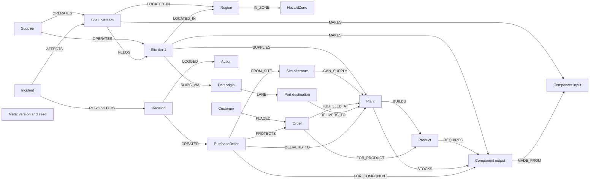
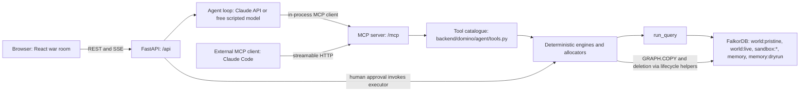

# DOMINO

**Track 1, Agents That Act on Connected Data**

## 1. Hero GIF and one-liner

TODO(gif)

DOMINO follows supply-chain dependencies, tests recovery plans in FalkorDB copies and executes the plan a human approves.

Live demo: TODO(url). Demo video: TODO(video).

## 2. The problem

A flood can stop a supplier you do not buy from directly. PowerCell and BatteryMax buy cells from VoltCell in Ayutthaya. Looking only at direct suppliers misses that shared dependency. An alternate supplier, AmpereOne, also depends on VoltCell, so a cheap backup may fail for the same reason.

This is a synthetic world for Kestrel Devices. The seed generator and checked-in queries let a reader inspect the assumptions.

## 3. What DOMINO does (6 phases)

1. Detect and trace: match an alert to known places, record the incident and follow upstream dependencies.
2. Measure impact and options: project shortages, compute clean capacity and check alternate suppliers.
3. Simulate: fork the live graph and score recovery strategies with the same engines.
4. Approve: show the proposed plan and wait for a human decision.
5. Execute: check the approved plan and commit purchase orders and allocations atomically.
6. Verify and remember: check the result, store lessons and produce a report with evidence references.

The UI groups tool calls into seven stages: Detect, Trace, Impact, Options, Simulate, Approve and Verify. The [architecture](docs/ARCHITECTURE.md) maps each stage to its tools.

## 4. Why a graph

Adapted from PLAN §6. Planned capabilities are marked so this table does not claim they already work.

| Capability | FalkorDB feature | What breaks without it | Current scope |
|---|---|---|---|
| Multi-tier exposure | Variable-length `FEEDS*0..4` paths | Dependency tracing and path evidence need another implementation. SQL can express recursive traversals too. | Implemented; traversal depth is bounded. |
| Hidden shared dependencies | Paths meeting at an upstream site | Backups sharing a failure point are missed. | Implemented. |
| Capacity and bottlenecks | `algo.maxFlow` on a projected network | Nominal tier-1 sums miss upstream limits and the min cut. | Implemented. |
| Single-point-of-failure scan | Repeated max-flow knockouts | No advance warning from hypothetical site failures. | Planned; not a current tool. |
| Port chokepoints | `algo.betweenness` | No graph-based port criticality ranking. | Planned; not a current tool. |
| Logistics rerouting | `algo.SPpaths` | No route search over the logistics network. | Planned; current engines use fixed transit days. |
| Alert-to-entity resolution | Full-text search on `Place` | Alerts cannot be resolved through the current tools. | Implemented. |
| What-if sandboxes | `GRAPH.COPY` | Strategies lose their isolated world copies. | Implemented. |
| Reset and per-visitor worlds | `GRAPH.COPY` and multiple graphs | A fresh live world needs another reset mechanism. | Reset implemented; current browser runs share the live world. |
| Memory across runs | Separate persistent memory graph | Remembered incidents and lessons disappear. | Implemented; scripted memory is separate. |
| Read-only queries | `GRAPH.RO_QUERY` | Reads lose the database-enforced read-only path. | Implemented. |
| Idempotent execution | Unique constraint on `PurchaseOrder.id` | Duplicate PO IDs lose their database guard. | Implemented with executor checks. |
| Provenance | Linked incidents, decisions, POs and actions | Graph links behind the execution audit disappear. | Implemented links; evidence is in run results, without planned `CITES` links. |

FalkorDB is part of the calculation and execution path. The graph-aware and tier-1 baseline allocators share code; the comparison tests the value of deeper supply-chain data, not a claim that a relational database cannot model it.

## 5. Data model

The world contains companies, physical sites, geography, parts, products, plants, customers and orders. Recovery adds incidents, decisions, purchase orders and audit actions. Memory lives in a separate graph. Days, weekly units and cents are integers.



See [DATA_MODEL.md](docs/DATA_MODEL.md) for node properties, relationship tables, indexes, constraints and differences from the plan. The [generated query reference](docs/QUERIES.md) contains the Cypher and its code references. Regenerate it with `make queries-md`.

## 6. Architecture diagram



The model chooses tools. Deterministic Python engines calculate results. A human approves the plan before the executor commits it. See [ARCHITECTURE.md](docs/ARCHITECTURE.md) for the files and run flow.

## 7. Agent and MCP tools

The server is mounted at `/mcp`. It exposes these names from `backend/domino/mcp/server.py`:

`health`, `resolve_entities`, `declare_incident`, `get_entity_context`, `recall_history`, `trace_exposure`, `explain_shared_dependencies`, `project_shortages`, `compute_true_capacity`, `find_alternatives`, `simulate_strategies`, `flag_orders_at_risk`, `submit_plan_for_approval`, `get_decision_status`, `verify_execution`, `record_lessons`, `submit_incident_report`.

`health` checks connectivity. The recovery tools validate IDs and return engine results. `execute_plan` is not exposed as an MCP tool. External clients propose a plan, wait for the human in the war room, then read its status.

| Mode | How it runs | Cost and requirements |
|---|---|---|
| Demo | Choose a scenario and press **Run the demo**. `agent/scripted.py` supplies model responses. | Free, scripted and offline after setup; still needs the local backend and FalkorDB. |
| Claude Code over MCP | Run `make agent-workspace`, then use the generated workspace with Claude Code and watch the war room. | Free with a Claude subscription; no Anthropic API key needed for this mode. |
| Claude API | Use the API mode with `ANTHROPIC_API_KEY` configured. | Paid and rate-limited by the application. |

## 8. Safety and verification

- The LLM never writes Cypher. Tools call fixed, parameterised queries through deterministic engines.
- Approval is bound to `plan_hash` and `world_version`. A changed world requires simulation again.
- Execution runs preflight, writes atomically and compares its receipt with the plan. A unique PO-ID constraint guards against duplicates.
- Verification checks approved spare, BOM compatibility, clean capacity, arrival deadlines, budget, PO uniqueness, complete order coverage, joint material balance and receipt counts.
- Orders covered by POs are **protected (projected)**. Parts have not yet arrived.
- **Not in the graph** does not mean **safe**.

See the verifier names and approval path in [ARCHITECTURE.md](docs/ARCHITECTURE.md).

## 9. Evaluation results

These entries are placeholders for engine-generated evaluation output. They are not measured results.

The [evaluation harness report](eval/RESULTS.md) records the current database blocker. [Database-free projection checks](eval/OFFLINE_CHECKS.md) and [read-only snapshot checks](eval/READ_ONLY_CHECKS.md) have separate, narrower scopes. Full recovery scoring remains incomplete; see the [environment incident and backups](eval/ENVIRONMENT.md).

| Method | Projected-late orders | Spend | Runtime |
|---|---|---|---|
| B0: do nothing | TODO(numbers) | TODO(numbers) | TODO(numbers) |
| B1: tier-1 greedy | TODO(numbers) | TODO(numbers) | TODO(numbers) |
| B2: graph-aware greedy | TODO(numbers) | TODO(numbers) | TODO(numbers) |

Test count: TODO(numbers). Query latency table: TODO(numbers). Evidence validity and verification results: TODO(numbers).

The current allocator is greedy. No optimality claim is made. The evaluation harness and submission metrics are still pending review; this skeleton does not treat planning targets as results.

## 10. Setup

Install Python 3.12, `uv`, `pnpm`, Node.js, Docker Compose and `make`. Python requirements are in `backend/pyproject.toml`; frontend commands and dependencies are in `frontend/package.json`.

From the repo root, using PowerShell:

```powershell
Copy-Item .env.example .env
uv sync --project backend
pnpm --dir frontend install --frozen-lockfile
make up
make seed
make dev
```

Set local configuration in `.env`. Keep secrets out of commits. Open the frontend at `http://localhost:5173`; the backend runs at `http://localhost:8000`. These addresses are defined in the existing development commands.

Environment variable names from `.env.example`:

`ANTHROPIC_API_KEY`, `DOMINO_MODEL`, `DOMINO_EFFORT`, `DOMINO_MAX_TOOL_CALLS`, `FALKORDB_HOST`, `FALKORDB_PORT`, `FALKORDB_IMAGE`, `WORLD_SEED`, `WORLD_GRAPH_PRISTINE`, `WORLD_GRAPH_LIVE`, `MEMORY_GRAPH`, `MCP_API_KEY`, `LIVE_RUNS_PER_HOUR_PER_IP`, `LIVE_RUNS_PER_DAY`, `DOMINO_DOMAIN`, `DOMINO_PUBLIC_HOST`.

### Run a scenario

The UI offers the following synthetic alerts from `backend/domino/agent/scenarios.py` and its seed motifs:

| Scenario | Title | Synthetic alert |
|---|---|---|
| `monsoon` | Monsoon flooding in the Chao Phraya Basin | Severe monsoon flooding across Ayutthaya and the Chao Phraya Basin; industrial estates closed, recovery expected in 3-5 weeks. |
| `panel_fire` | Fire at Lumenvue Display, Suzhou | Fire at Lumenvue Display's Suzhou module plant; production halted for about two weeks. |
| `non_event` | Port strike in Antwerp | Dock workers' strike closes the Port of Antwerp for about a week. |

The Antwerp case tests whether the agent reports an unknown location honestly.

For a free headless scripted run:

```powershell
make demo-headless SCENARIO=monsoon DRY_RUN=1
```

Run `make test` for backend tests. Run `pnpm --dir frontend lint` and `pnpm --dir frontend build` for frontend checks. To use Claude Code as the agent, keep the app running and run `make agent-workspace`; see [deployment and MCP instructions](docs/DEPLOY.md) for hosted configuration and authentication. Deployment status and public access still need author review.

## 11. Limitations and assumptions

- All data and alerts are synthetic. There is no real ERP or supplier integration.
- Max-flow is a single-commodity bound for each component/plant pair. The allocator and verifier account for shared upstream inputs across the plan.
- Greedy allocation is deterministic but not guaranteed optimal. Weekly rates and integer simulation days simplify operations.
- The sandbox uses a deterministic reality model, not a forecast of a real supplier’s behaviour.
- Dependency traversal is bounded. Unknown or unmodelled entities do not establish safety.
- The browser currently shares a live world. Resets and changes can invalidate another plan.
- Routing, proactive risk scans, live arrival tracking and the planned memory reliability feedback are not established by this skeleton.

## 12. AI disclosure

Read the [AI assistance disclosure](docs/AI_DISCLOSURE.md) and [design decisions](docs/DECISIONS.md) for the work history and review responsibilities.

`docs/PLAN.md` holds planning notes written before the start (allowed by rule 8); all code was written after Oct 15 00:01 IST, and the commit history shows it.

The [plan](docs/PLAN.md) is historical design material. The implemented-model and architecture documents identify where the current code differs. Final numbers, media and publication links remain marked with TODOs for review.

## 13. Credits

Built by Arihant Jain for WeMakeDevs × FalkorDB Graph Hacks 2026. **Track 1, Agents That Act on Connected Data**.

FalkorDB provides graph storage and algorithms. The app uses Python, FastAPI, the MCP SDK, React, Zustand and Vite. Claude Code and Codex assisted with implementation, documentation and cleanup as recorded in the [disclosure](docs/AI_DISCLOSURE.md).

Licensed under the [MIT License](LICENSE).
