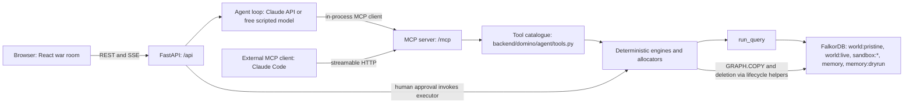

# Architecture

DOMINO separates model decisions, deterministic calculations and human approval.

## Browser

`frontend/src/App.tsx` and `frontend/src/components/` render the war room. `frontend/src/lib/store.ts` keeps run state from API responses and streamed events; `lib/sse.ts` subscribes to the stream. The browser presents exposure, capacity, simulated plans and verification from those results and lets a human approve a plan.

## FastAPI and MCP server

`backend/domino/api/main.py` mounts REST routes under `/api` and the streamable HTTP MCP server under `/mcp`. `api/runs.py` starts runs, streams SSE events and handles approval and rejection. In production the same app can serve the built frontend. `mcp/server.py` wraps the tool catalogue with `asyncio.to_thread` for synchronous engines and captures the executed queries for the UI. Its `health` tool checks FalkorDB connectivity.

## Agent loop and external MCP client

`backend/domino/agent/loop.py` chooses tools through an MCP client, streams progress, persists run state under `backend/runs/` and pauses for approval. It supports a Claude API client or the free deterministic stand-in in `agent/scripted.py`. An external client such as Claude Code calls the same server over HTTP; `agent/external.py` records its calls for the war room. `scripts/agent_workspace.py`, run by `make agent-workspace`, prepares that client’s workspace. After approval, the application calls the executor and resumes reporting.

## Tool catalogue

`backend/domino/agent/tools.py` validates entity IDs and provides fixed, parameterised tools. It records compact summaries with result references for the model and full results for the UI. Unknown IDs produce `unknown_entity`. Reports validate evidence and metric references against results in the current run. `execute_plan` is deliberately absent from the MCP tool catalogue.

## Engines and allocators

`backend/domino/engines/` computes incidents, exposure, shortages, max-flow capacity, alternatives, sandbox results and verification without an LLM. `allocators/greedy.py` allocates complete component coverage using a strategy preset and, in graph-aware modes, upstream capacity bookkeeping. `engines/sandbox.py` forks the live graph, executes each candidate through the same executor, scores it, verifies it and deletes the fork. `engines/executor.py` checks approval and preflight before the atomic write. `agent/memory.py` writes remembered incidents, lessons and delivery facts through named queries. `engines/delivery.py` fast-forwards executed purchase orders to delivery and computes the supplier reliability learned from past deliveries, which `allocators/greedy.py` uses for the balanced strategy.

## Query runner

`backend/domino/graph/run_query.py` loads named Cypher from `backend/domino/queries/`. Reads use `GRAPH.RO_QUERY` by default; explicit writes use the write path. It records query name, text, parameters, elapsed time and row count, sets query timeouts and raises when a result may have been truncated. `capture_queries` and `group_records` feed the Cypher drawer. The generated [query reference](QUERIES.md) documents the checked-in query files and their literal code references.

## FalkorDB graphs

`backend/domino/graph/lifecycle.py` loads a generated world into `world:pristine`, applies the schema and resets `world:live` with `GRAPH.COPY`. Sandboxes use `sandbox:<run>:<strategy>` copies; the Risk X-ray re-checks its worst sites on `sandbox:xray:<graph>:<site>` copies (`engines/xray.py`). `engines/capacity.py` also creates temporary `scratch:flow:*` graphs for node-split max-flow networks and deletes them in `finally`. `agent/context.py` directs real lessons to `memory` and scripted lessons to `memory:dryrun`; world reset does not reset memory. See the [data model](DATA_MODEL.md) for labels, fields and constraints.

## One run, step by step

The stages and tool names below are copied from `STEPS` in `frontend/src/lib/store.ts`. They group activity in the UI; an agent can skip tools when the facts do not require them.

| Stage | Tools |
|---|---|
| Detect | `resolve_entities`, `declare_incident` |
| Trace | `trace_exposure`, `explain_shared_dependencies`, `get_entity_context`, `recall_history`, `scan_single_points_of_failure` |
| Impact | `project_shortages`, `flag_orders_at_risk` |
| Options | `compute_true_capacity`, `find_alternatives` |
| Simulate | `simulate_strategies` |
| Approve | `submit_plan_for_approval`, `get_decision_status` |
| Verify | `verify_execution`, `record_lessons`, `submit_incident_report` |

## Safety

The LLM never writes Cypher. Tools accept parameters for checked-in queries and deterministic engines. Only the human approval path calls live execution; sandbox evaluation executes candidate plans in graph copies.

Approval is bound to `plan_hash` and `world_version` in `engines/executor.py` and `queries/decision/`. A changed world requires a fresh simulation. Execution runs preflight, then `queries/execute/write.cypher` checks the approved hash and current version and creates the purchase orders, allocations and audit action in one atomic query. The executor compares receipt counts with the plan. A unique constraint on `PurchaseOrder.id` prevents duplicate IDs.

Verifier names copied from `NAMES` in `backend/domino/engines/verifier.py`:

- **V1:** alternate sources within approved spare
- **V2:** every protected part is BOM-approved for the product
- **V3:** PO rates within remaining clean capacity (max-flow)
- **V4:** every allocation arrives by the order's need day
- **V5:** spend within the decision budget
- **V6:** one PO per decision, site, part and plant
- **V7:** protected orders fully covered
- **V8:** material balance at every upstream site, across the whole plan
- **V9:** execution receipt matches the plan

Purchase orders mean **protected (projected)**, because parts have not yet arrived. An unresolved place or company is **not in the graph**; that does not establish safety.
