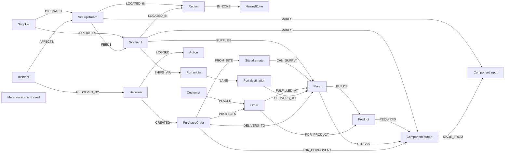

# Data model

This matches the seed generator, schema and checked-in write queries. The code is the source of truth. Property lists describe what writers create, not mandatory database constraints.

## Conventions

- IDs are strings with domain prefixes, such as `S-VOLT-AYU`, `PL-BAC`, `BAT-4S`, `SO-1000` and `INC-0001`.
- Simulation time uses integer days. Day 0 is the incident day; `need_day = due_day - build_days`.
- Capacity and flow use integer units per week. Quantities use integer units. Money uses integer cents and is displayed in USD.
- `capacity_factor` and supplier `reliability` are fractions; latitude and longitude are coordinates.
- Seeded sites start `active` with `capacity_factor = 1.0`. Incident declaration sets affected sites to `disrupted` and sets the factor and `disrupted_until`.
- Randomness comes from `WORLD_SEED`; `seed/generator.py` uses separate deterministic random streams per phase.
- `Place` is an additional label on Site, Region, HazardZone, Port and Plant. Aliases are a single string. One full-text index searches their names and aliases.

## World nodes

Seeded properties below are collected from `backend/domino/seed/generator.py` and `motifs.py`; labels are applied by `queries/seed/nodes_*.cypher`.

| Label | Created properties |
|---|---|
| `Supplier` | `hq_country`, `id`, `name`, `reliability`. |
| `Site:Place` | `aliases`, `capacity_factor`, `capacity_wk`, `id`, `input_buffer_days`, `kind`, `lat`, `lng`, `name`, `status`, `tier`, `unit`. Runtime adds `disrupted_until`. |
| `Region:Place` | `aliases`, `country`, `id`, `lat`, `lng`, `name`. |
| `HazardZone:Place` | `aliases`, `hazard`, `id`, `name`. |
| `Port:Place` | `aliases`, `country`, `id`, `kind`, `lat`, `lng`, `name`, `status`. |
| `Plant:Place` | `aliases`, `country`, `id`, `lat`, `lng`, `name`. |
| `Component` | `family`, `id`, `name`, `unit`, `unit_cost_cents`. |
| `Product` | `build_days`, `id`, `name`, `unit_price_cents`. |
| `Customer` | `country`, `id`, `name`, `penalty_per_day_cents`, `tier`. |
| `Order` | `due_day`, `id`, `need_day`, `qty`, `risk_flag`, `status`, `value_cents`. Runtime adds `risk_reason`; status may become `protected_projected`. |
| `Meta` | `id`, `world_version`, `seed`, `fingerprint`. Created by `queries/seed/meta.cypher`; incident declaration and execution increment the version. |
| `Incident` | `id`, `kind`, `title`, `alert_text`, `started_day`, `expected_end_day`, `severity`, `status` (`open`). |
| `Decision` | `id`, `strategy`, `status`, `plan_hash`, `world_version`, `budget_cents`, `rationale`; approval adds `approved_by`, execution adds `executed_day`, rejection adds `rejected_by` and `feedback`. Writers set `proposed`, then `approved` and `executed`, or `rejected`. A plan re-submitted after a rejection gets a revision id (`DEC-...-v1-r2`). |
| `PurchaseOrder` | `id`, `qty`, `rate_wk`, `unit_price_cents`, `mode`, `first_arrival_day`, `status` (`committed`), `created_by` (`domino`). IDs are deterministic in `allocators/greedy.py`. |
| `Action` | `id`, `type` (`execute`), `actor` (`executor`), `day`, `payload_json`. |

Purchase orders protect orders **(projected)**. They do not establish that parts have arrived. Runtime fields come from `queries/incident/declare.cypher`, `agent/flag_orders.cypher`, `decision/*.cypher` and `execute/write.cypher`.

## World relationships

| Pattern | Created properties | Meaning |
|---|---|---|
| `(Supplier)-[:OPERATES]->(Site)` | — | Company operates a physical site. |
| `(Site / Port / Plant)-[:LOCATED_IN]->(Region)` | — | Physical location. |
| `(Region)-[:IN_ZONE]->(HazardZone)` | — | Correlated geographic risk. |
| `(Site)-[:MAKES]->(Component)` | `unit_price_cents` | Site output. |
| `(Component)-[:MADE_FROM]->(Component)` | `qty` | Component bill of materials. |
| `(Site)-[:FEEDS]->(Site)` | `cap_wk`, `component_id`, `used_wk` | Upstream material flow. |
| `(Site)-[:SUPPLIES]->(Plant)` | `component_id`, `transit_days`, `unit_price_cents`, `used_wk` | Active supply contract. |
| `(Site)-[:CAN_SUPPLY]->(Plant)` | `air_surcharge_cents`, `air_transit_days`, `component_id`, `lead_days`, `moq`, `qualified`, `spare_wk`, `transit_days`, `unit_price_cents`, `reserved_wk (added by execution)` | Approved alternate capacity. |
| `(Product)-[:REQUIRES]->(Component)` | `qty` | Product bill of materials. |
| `(Plant)-[:BUILDS]->(Product)` | `cap_day` | Assembly capability. |
| `(Plant)-[:STOCKS]->(Component)` | `on_hand`, `safety` | Plant inventory. |
| `(Customer)-[:PLACED]->(Order)` | — | Customer demand. |
| `(Order)-[:FOR_PRODUCT]->(Product)` | — | Ordered product. |
| `(Order)-[:FULFILLED_AT]->(Plant)` | — | Assigned assembly plant; the edge does not mean an order has shipped. |
| `(Site)-[:SHIPS_VIA]->(Port)` | `cost_cents`, `days`, `mode` | Site access to a port. |
| `(Port)-[:LANE]->(Port)` | `cap_wk`, `cost_cents`, `days`, `eff_days`, `mode` | Port-to-port transport. |
| `(Port)-[:DELIVERS_TO]->(Plant)` | `cost_cents`, `days`, `mode` | Port access to an assembly plant. |
| `(Product)-[:ALLOWS_ALTERNATE]->(Component)` | `qty`, `for_component` | Supported by `queries/seed/edges_allows_alternate.cypher`; the current generator creates no rows. `for_component` is read by `queries/alternatives/acceptable.cypher`. |
| `(Incident)-[:AFFECTS]->(Site)` | `factor` | Observed disruption. |
| `(Incident)-[:RESOLVED_BY]->(Decision)` | — | Proposed recovery decision. |
| `(Decision)-[:CREATED]->(PurchaseOrder)` | — | Purchase order recorded by execution. |
| `(PurchaseOrder)-[:FROM_SITE]->(Site)` | — | Purchase-order source. |
| `(PurchaseOrder)-[:FOR_COMPONENT]->(Component)` | — | Purchased part. |
| `(PurchaseOrder)-[:DELIVERS_TO]->(Plant)` | — | Purchase-order destination; distinct from the logistics edge of the same type. |
| `(PurchaseOrder)-[:PROTECTS]->(Order)` | `qty`, `arrival_day` | Projected allocation. |
| `(Decision)-[:LOGGED]->(Action)` | — | Execution audit record. |

## World diagram



`Place` is an additional label on the location nodes in this diagram. `Meta` is intentionally unconnected. The diagram omits the supported but currently unseeded `ALLOWS_ALTERNATE` edge.

## Memory and temporary graphs

`agent/memory.py` and `queries/memory/` write the following in `memory`; scripted runs use `memory:dryrun` (`agent/context.py`). They survive a live-world reset.

| Label or relationship | Created properties |
|---|---|
| `Incident` | `id` (memory's own id, `MI-0001`, `MI-0002`...), `incident_id` (the id it had in its world run, e.g. `INC-0001`), `run_id`, `title`, `outcome`, `learned_on`. World incident ids restart after every reset, so memory keeps its own ids and a new run adds to memory instead of overwriting it. Memories written before Oct 18 use the world id as `id` and have no `incident_id`. |
| `Entity` | `id`, `kind`, `name` for involved entities; an entity linked only by a lesson can initially have just `id`. |
| `Lesson` | `id` (`L-<memory incident>-<n>`), `text`, `incident_id` (the memory incident), `learned_on`, `evidence` (a string of evidence IDs). The same text sent twice for one incident is stored once. |
| `(Incident)-[:INVOLVED]->(Entity)` | `role` |
| `(Lesson)-[:ABOUT]->(Entity)` | — |

`learned_on` is a calendar date, separate from integer simulation days. The recall query reads `Entity.reliability`, but no current memory writer sets it.

For max-flow, `queries/flow/load_nodes.cypher` creates `F {id}` nodes and `load_edges.cypher` creates `CAP {cap, cap_nominal}` edges in `scratch:flow:*`. Site nodes are split into input/output halves. Capacities are converted to units of the target component per week. `engines/capacity.py` deletes the scratch graph in `finally`. `sandbox:*` graphs copy the world model and are dropped after scoring by `engines/sandbox.py`.

## Indexes and constraints

Exact schema from `backend/domino/queries/schema/indexes.cypher`:

```cypher
CREATE INDEX FOR (n:Site) ON (n.id);
CREATE INDEX FOR (n:Order) ON (n.id);
CREATE INDEX FOR (n:Component) ON (n.id);
CREATE INDEX FOR (n:Plant) ON (n.id);
CREATE INDEX FOR (n:PurchaseOrder) ON (n.id);
CREATE INDEX FOR (n:Incident) ON (n.id);
CREATE INDEX FOR (n:Place) ON (n.id);
CREATE INDEX FOR (n:Supplier) ON (n.id);
CREATE INDEX FOR (n:Product) ON (n.id);
CREATE INDEX FOR (n:Customer) ON (n.id);
CALL db.idx.fulltext.createNodeIndex('Place', 'name', 'aliases')
```

`backend/domino/graph/schema.py` then issues the Redis command below and polls `schema/constraints` until the constraint is `OPERATIONAL`; failure or timeout stops schema setup.

```text
GRAPH.CONSTRAINT CREATE world:pristine UNIQUE NODE PurchaseOrder PROPERTIES 1 id
```

The exact-match index on `PurchaseOrder.id` is created first. The constraint prevents duplicate IDs; the executor also checks decision state and existing IDs. `graph/lifecycle.py` applies schema to pristine and copies the indexes and constraint with `GRAPH.COPY`.
