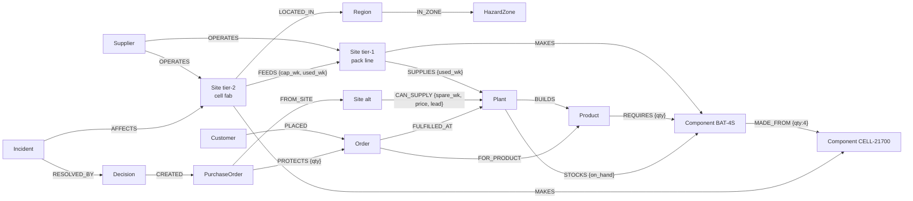

# DOMINO — Master Build Plan

**An autonomous agent that recovers multi-tier supply chains, built on FalkorDB**
WeMakeDevs × FalkorDB **Graph Hacks 2026** · Track 1: *Agents That Act on Connected Data* · Solo build
Plan v2 · written Oct 14, 2026, before the hackathon starts. Planning is allowed before the start; project code is not (rule 8).

> **One line:** DOMINO reads a disaster alert and follows the graph down to your suppliers' suppliers. It proves that your "independent" backup suppliers depend on the same flooded factory, and it uses FalkorDB's max-flow algorithm to compute how much capacity is really left. It tests recovery plans on forked copies of the graph, executes the plan you approve, and checks that the plan worked.
>
> **Tagline:** *When one link breaks, DOMINO saves the chain.*

---

## Table of contents

0. [TL;DR](#0-tldr)
   - [0.1 Update, Oct 16: crunch plan, fixes, additions (READ FIRST)](#01-update-oct-16-read-this-before-anything-else)
   - [0.2 Second review: organizer guidance, design bugs fixed, new feature order](#02-second-review-oct-16-evening-what-was-adopted)
1. [Verified hackathon facts](#1-verified-hackathon-facts)
2. [Review of the Codex plan: what was wrong](#2-review-of-the-codex-plan)
3. [The pitch](#3-the-pitch)
4. [Feature scope: P0 / P1 / P2 with acceptance criteria](#4-feature-scope)
5. [The synthetic world and the graph data model](#5-the-world-and-the-graph-data-model)
6. [What FalkorDB does, and what breaks without it](#6-what-falkordb-does)
7. [Deterministic engines](#7-deterministic-engines)
8. [Core Cypher queries (these get submitted)](#8-core-cypher-queries)
9. [The agent: loop, MCP tools, policy, prompt](#9-the-agent)
10. [Backend API and SSE events](#10-backend-api-and-sse-events)
11. [Frontend: the single "war room" screen](#11-frontend)
12. [Scenarios](#12-scenarios)
13. [Evaluation plan](#13-evaluation-plan)
14. [Tech stack, repo layout, deployment](#14-tech-stack-repo-layout-deployment)
15. [Day-by-day timeline with gates and cut lines](#15-timeline)
16. [Demo script (3:00) and video](#16-demo-script)
17. [Submission checklist, README outline, blog post](#17-submission)
18. [Risks and mitigations](#18-risks)
19. [What NOT to build](#19-what-not-to-build)
20. [Judge Q&A prep and what you must understand](#20-judge-qa--learning)
21. [Claude Code prompts for each milestone](#21-claude-code-prompts)
22. [Decisions needed from you](#22-decisions-needed-from-you)

---

## 0. TL;DR

- **Verdict: GO with DOMINO.** The domain fits Track 1 well. The event page uses *"What breaks if this service goes down?"* as its example of a question that needs a graph, and that is exactly DOMINO's question.
- **What changes from the Codex version:** it modelled a single, fixed supplier→component→product→factory→order chain. A judge can reasonably say "that's a 4-table SQL join." Rule 3 says that if the product still works with FalkorDB removed, the graph is just decoration. v2 is rebuilt around **hidden multi-tier dependencies**, which are only practical to find with graph traversal and graph algorithms.
- **The key demo moment:**
  1. A tier-1-only view says *"No suppliers in the flood zone ✅"*.
  2. DOMINO walks the graph and shows that two "independent" battery suppliers both buy cells from **VoltCell, a tier-2 cell factory inside the flood zone**.
  3. Battery capacity looks like ~3,350 packs/week in the tier-1 view. FalkorDB `algo.maxFlow` over the real multi-tier network gives ~1,350. (These are design targets for the data generator; the app always shows computed values.)
  4. The **cheapest alternative supplier is a trap**: its cells come from the same flooded factory.
  5. The naive plan and DOMINO's plan are each executed in a **GRAPH.COPY sandbox** and scored with the same engine.
- **FalkorDB does real work in 13 places** (§6), including variable-length traversal, `algo.maxFlow`, `algo.SPpaths`, `algo.betweenness`, full-text search, `GRAPH.COPY` sandboxes, separate world and memory graphs, `GRAPH.RO_QUERY` for every read tool, and unique constraints that make execution idempotent.
- **Architecture:** one Claude agent picks tools through **MCP**. Deterministic engines (Cypher, graph algorithms and a CP-SAT optimizer) produce every number. Commitments need human approval. Verification runs 9 invariants (7 in Cypher, 2 cross-checks).
- **Build order:** graph → engines → agent → UI → eval → ship. P0 must be finished by the end of Day 3. Day 4 is for evaluation, deployment, video and blog post.
- **Submit by 21:00 IST on Oct 18.** The official deadline is 23:59 IST; the 3 hours in between are buffer, not work time.

---

## 0.1 Update, Oct 16: read this before anything else

**Where things stand (Fri Oct 16, 19:00 IST):**
- Nothing has been built yet.
- About 50 hours remain until the 21:00 IST Sunday target. After sleep and meals that's roughly **30 focused hours**.
- The 4-day timeline in §15.2–15.5 no longer fits. **Use the crunch timeline below.** Every other section stays as the reference design.
- Rules re-checked today: unchanged. Judging criteria: still not published.

### What changes for the crunch

| Area | Original plan | Crunch plan |
|---|---|---|
| DOMINO's allocator | CP-SAT MILP (§7.9) | **Graph-aware greedy with upstream bookkeeping** (below). CP-SAT only if Sunday morning has spare time |
| Demo scenarios | Monsoon, Scarce Silicon, Panel Fire | Monsoon (must). Panel Fire (cheap, same engines). Scarce Silicon only if there's time |
| Evaluation | Every method, with LLM runs | Deterministic methods B0/B1/B2 on ~20 generated worlds (**no LLM; runs in seconds**). The agent (A) on 3 scenarios × 2 runs |
| P1 list | 12 items | Only the cheap, high-impact additions in the table further down |
| Memory | Basic, P0 | Keep basic (about 1 hour): write at incident close, recall on the next run |
| Blog post | Day 4 | Draft while the video renders. Skip it if you're behind |

### Graph-aware greedy allocator (replaces CP-SAT as the default)

```
remaining_rate[src]   = weekly deliverable rate
                        graph-aware: the standalone max-flow capacity (§7.6)
                        naive:       the tier-1 nominal capacity
remaining_cells[fab]  = capacity_wk × factor for each upstream site (graph-aware only)

for order in sorted(orders_needing_component, key = (need_day, not strategic, id)):
    need = units still uncovered after inventory and pipeline
    for src in feasible sources, sorted by (price + risk + expedite cost):
        # feasible = compatible part, arrival_day ≤ need_day, and (graph-aware only) remaining clean capacity > 0
        # (an exposed supplier with a healthy second input is still usable, at reduced capacity)
        room = what src can deliver by need_day at its remaining rate
        if graph-aware:
            room = min(room, min over src's FEEDS inputs of remaining_cells[fab] ÷ BOM ratio, capped by the FEEDS cap)
        take = min(need, room); deduct rate and cells; record the allocation
        if need == 0: break
```

- **Naive mode is baseline B1** (price only, nominal capacity, no taint check, no cell bookkeeping). **Graph-aware mode is DOMINO.** The two runs use the same code; the only difference is the graph. That makes the comparison fair and easy to explain.
- The cell bookkeeping is what captures contention: Hanriver's cells shared by PowerCell and ElectroHub, and Kanto's cell line shared by its 4S and 6S packs.
- Be honest that greedy isn't guaranteed optimal. CP-SAT (§7.9) is the upgrade if time allows.

### Crunch timeline

**Tonight, Fri Oct 16 (19:30 → 02:00, about 6 h)**

| Time | Work | Done when |
|---|---|---|
| 19:30–20:15 | Decisions (§22), API spend limit, repo + first commit, CLAUDE.md, `docker compose up`, spike (§15.2 M1 list plus the 3 new checks below) | `SPIKE.md` all ✓ or fallbacks noted |
| 20:15–23:00 | World generator: Monsoon + Panel Fire motifs, light random fill (~300 nodes is fine tonight), loader, schema, pristine → live | `make seed` works; FalkorDB Browser screenshot |
| 23:00–02:00 | Exposure, tier-1 view and shortage engine, with tiny-world tests and the healthy-baseline test | CLI prints Monsoon: tier-1 view **0** vs multi-tier **2 via VoltCell**, plus the projected-late list |

**Saturday Oct 17 (09:00 → 01:00)**

| Time | Work | Done when |
|---|---|---|
| 09:00–11:00 | Capacity (max-flow on a scratch graph) and alternatives with the taint check | Naive vs true capacity; AmpereOne rejected with its path |
| 11:00–13:30 | Greedy allocator (both modes), strategies, `GRAPH.COPY` sandboxes, executor, verifier V1–V7 and V9 | Sandbox table: baseline vs DOMINO. Executing twice creates 0 duplicates |
| 14:00–17:30 | MCP server, agent loop, approval pause/resume, SSE, basic memory | `make demo-headless SCENARIO=monsoon` runs end to end |
| 17:30–18:15 | Deploy the skeleton to the VPS; test SSE through the proxy | Public `/health` responds and a test SSE streams |
| 18:15–01:00 | Frontend: ELK-tiered canvas, timeline, KPIs, propagation, plan comparison, approval, verify panel with the graph-diff receipt | The full Monsoon loop is clickable locally |

**Sunday Oct 18 (08:30 → 21:00)**

| Time | Work | Done when |
|---|---|---|
| 08:30–10:30 | Panel Fire scenario, 3 rehearsals of each scenario, prompt fixes, **backup video take** | 6/6 runs complete |
| 10:30–12:00 | Evaluation: deterministic methods on ~20 worlds, agent on 3 scenarios × 2 | `RESULTS.md` generated by a script |
| 12:00–13:00 | Final deploy, replay mode, rate limit | URL is safe for judges |
| 13:00–14:30 | README, DATA_MODEL, QUERIES.md (generated), AI_DISCLOSURE | §17.1 all ✓ |
| 14:30–17:00 | Record and edit the video (§16) while you're still fresh, not at 2 AM | Uploaded; link works when logged out |
| 17:00–18:30 | Blog post (skip if behind) and the 10-second MCP client clip | — |
| 18:30–21:00 | Submit. Check every link in a private window | Confirmation screenshot |
| 21:00–23:59 | **Buffer only** | — |

**Never cut:**
- Monsoon end to end.
- The tier-1 vs multi-tier contrast.
- `algo.maxFlow`.
- AmpereOne's taint rejection.
- Baseline vs DOMINO compared in `GRAPH.COPY` sandboxes.
- The agent working over MCP.
- Approve → atomic execute → verify.
- README with the data model, plus QUERIES.md.
- The video.

**Cut order if behind** (cut from the top): Scarce Silicon → blog post → Cypher drawer → Panel Fire → memory recall (keep the write) → live deployment (the FAQ accepts local setup + video) → LLM eval runs (keep the deterministic eval).

### Fixes found on recheck (already folded into the sections below)

1. **Partial execution bug in Q-EXECUTE (§8).**
   - If one PO's `MATCH` finds nothing, that row silently drops, the rest of the plan still executes, and the decision gets marked executed anyway.
   - `UNWIND po.allocations` on an empty list also drops the row.
   - **Fix:** a preflight read query must return exactly N matchable POs, and POs with no allocations are rejected. The write query returns the number of POs and `PROTECTS` edges it created, and new invariant **V9 (receipt matches plan)** compares them with the plan.
2. **Rollback on a constraint error isn't confirmed.** Add to the spike: when a write query hits the unique constraint, is the whole query rolled back? If not, check for existing PO IDs in the preflight (application-level idempotency) and keep the constraint as a backstop.
3. **Inline maps that use UNWIND variables** (`{id: po.site_id}`): confirm in the spike; otherwise switch to `WHERE`.
4. **MCP mounted inside FastAPI:** FastMCP's session manager has to start in FastAPI's lifespan, or `/mcp` returns errors. If it fights you for more than 30 minutes, run the MCP server as a separate process on port 8001.
5. **Blocking calls freeze SSE:** engines are synchronous (FalkorDB client, solver). Call them through `await asyncio.to_thread(...)` from async code.
6. The TL;DR said FalkorDB did real work in "10 places", but §6 lists 13. Fixed.

### New additions, ranked by value for effort

| Addition | Why judges care | Effort | Tier |
|---|---|---|---|
| **Net-benefit line** in the plan comparison: "spend $X → avoid $Y in penalties and protect $Z of revenue → net $W" | Turns the decision into one obvious number | 20 min | **P0** |
| **Graph-diff receipt** after execution: "+4 PurchaseOrder, +23 PROTECTS, 23 orders → protected (projected)" | Proves the agent actually changed the graph | 30 min | **P0** |
| **Transparency note** in the README: "docs/PLAN.md was written before the start as planning notes (allowed by rule 8); all code was written after Oct 15 00:01 IST" | Defuses any rule-8 doubt before it comes up | 5 min | **P0** |
| **Pre-written submission text**: one line, 50 words and 200 words, plus a justification for the track. Write it Saturday night | No scrambling at 20:00 Sunday | 20 min | **P0** |
| **Reasoning graph:** save every tool call as a `(:Step)` node with `[:NEXT]` to the following step and `[:READ]`/`[:WROTE]` edges to the entities it used. A "How DOMINO got here" button renders it | Directly matches the brief: "show the path behind an answer" | 1.5 h | P1 |
| **Robustness check:** the alert says 3–5 weeks, so score each strategy in sandboxes for 21-, 28- and 35-day outages and recommend the one that holds up | Decision-making under uncertainty, not a single guess | 1 h | P1 |
| **Query performance table:** p50/p95 ms for every named query, taken from the `run_query` logs, in RESULTS.md | FalkorDB's own team will read it | 30 min | P1 |
| **Alert triage inbox:** 5 alerts scored by graph exposure in milliseconds without the LLM; only relevant ones go to the agent | Shows the DETECT step working, and it's cheap to run | 1.5 h | P1 |
| **What-if mode:** "What if Kaohsiung also closes?" runs as an incident inside a sandbox fork, leaving the live world untouched | Reuses the sandbox code; nice to show live | 1 h | P2 |
| **Scale benchmark:** the same queries on a 50k-node generated world | Shows off FalkorDB's speed | 1 h | P2 |
| **Ask in the FalkorDB Discord:** is `algo.maxFlow` in the Docker tag you're using, and will judging criteria be published? | Removes your biggest technical unknown in 5 minutes | 5 min | **Now** |

---

## 0.2 Second review (Oct 16, evening): what was adopted

An outside review of this plan was checked line by line against the plan, the FalkorDB docs and the organizers' Oct 15 guide.

### Organizer guidance that shapes judging (WeMakeDevs blog, Oct 15)

"How to Build an Agent That Reasons Over a Graph", by the WeMakeDevs COO, has a section on what judges look for:

- **The core question is whether the graph does work the agent couldn't do without it.**
- **Their strongest demo move is depth 1 vs depth 4:** the same question asked shallow (looks like a join) and then deep (finds a hidden dependency 3 hops away, with the path). This is exactly DOMINO's tier-1 view ↔ multi-tier toggle. **Keep it as the first demo beat.**
- **Ask something that isn't in the graph and let the agent say so.** An empty traversal isn't safety. → Scenario F wording, plus answer outcomes in the system prompt.
- **The agent should not write Cypher.** A fixed, human-written, parameterised tool catalogue over MCP, with arguments validated against the graph. → `query_graph_readonly` removed.
- **Memory is more nodes, returned with the date it was learned.** → `recall_history` returns dates.
- **Every answer carries its path, and the model's sentence is checked against the rows.** → Structured claims plus the entity guard (§9.4, §9.7).
- They say one submission is judged in one track. → **Track 1 only.**
- They call max-flow "unexpectedly good for capacity questions", which supports DOMINO's centerpiece.

### Design bugs fixed (all verified as real)

| Bug | Fix (section) |
|---|---|
| Any disrupted ancestor rejected a supplier. That contradicted our own "PowerCell extra via Hanriver" design | Exposure is a warning. Reject only when remaining clean capacity is 0 (§7.7, V3) |
| Sandbox capacity was computed one supplier at a time, so shared upstream cells were double-counted | Joint, tier-by-tier proportional rationing across all commitments (§7.10) |
| V8 checked each component separately | Material balance across the whole plan, per upstream site (§7.12) |
| Weighted input availability treated complementary BOM inputs as interchangeable | Minimum over required input components (§7.5) |
| "Saturated edges are bottlenecks" (wrong; FalkorDB also returns only positive-flow edges) | Min cut from residual reachability on the full projected network in Python, confirmed by experiment (§7.6) |
| Approval wasn't tied to a world state | `world_version` binding; re-simulate and re-approve on material change (§7.11) |
| A valid evidence ID could be cited for an unrelated claim | Structured claims validated against path entities, units and version (§9.4) |
| "SQL can't do unknown depth" (wrong: recursive CTEs exist) | Claim native graph model, algorithms, evidence and sandboxes instead (§6, §20) |
| "B1 vs B2 = value of a graph database" | Renamed: value of multi-tier graph reasoning (§13) |
| Tool-path diversity as proof of agency | Outcome-based agency metrics plus adversarial fixtures (§13) |

### New features, ordered for the time left

None of these start before the Saturday-night gate (full Monsoon loop clickable). The review assumed unlimited build time; we have about 30 hours.

| Order | Feature | Cheapest version that still lands | Effort |
|---|---|---|---|
| **1** | **Second disruption → repair the plan → remember** (promotes P1-3/P1-4) | After execution, "Day 7: ElectroHub reports a 50% shortfall" (a capacity_factor change event). Verification flags the protected orders that are now threatened. Re-run the allocator **with still-valid POs locked**, so the change is as small as possible. Show **old plan → changed fact → affected orders → revised plan (+$ extra)**. Write an Outcome to memory, and the next run cites it | 3–4 h |
| **2** | **Stress-test this plan** (merges P1-14) | Score every strategy in sandboxes against 5–6 futures **generated from the graph**: a longer outage, a backup delivering 60%, a second site in the same region or hazard zone failing, a port closing after procurement, +20% demand. Show base-case vs worst-case orders protected, and *which* assumption breaks the plan. Report "passed N of M tested futures", never a probability | 2 h |
| **3** | **"What would save this order?"** | Click an unprotected order. Re-run the allocator with one relaxation at a time: budget +X, allow air, accept due date +N days, allow an approved substitute (skip inter-plant transfer unless already modelled). Show only options that **actually make it feasible in the sandbox**, plus their side effects on other orders. If none work, name the binding constraint (min cut / capacity / lead time) | 2 h |
| 4 | Unknown or stale supplier information (lite) | Add `upstream_known` and `last_verified_day` on CAN_SUPPLY. For a candidate with unknown upstream, the agent says so ("appears independent, cell source unverified"). A `request_supplier_declaration` tool returns a pre-written synthetic declaration, updates the graph, and re-runs. It gives the agent a real "what do I investigate next" choice | 1.5 h |
| 5 | Prevention planner (extends P1-2) | Fixed resilience budget. Compare 3–4 interventions (qualify an independent cell fab, add a tier-1 supplier, extra stock at Penang, alternate lane) against the stress-test suite. Expected finding: another tier-1 supplier helps little; an independent cell fab helps a lot | P2 |
| 6 | "Try to break DOMINO" mode | Manual injection plus a duration/budget/second-incident panel plus a **reproducible scenario seed**, with the baseline shown alongside. Include cases where full recovery is impossible, and explain the unavoidable loss | P2 |

**Target showcase if items 1–3 ship:** hidden dependency found → cheapest backup exposed → plans stress-tested → human approves → a second disruption hits → DOMINO repairs the plan with minimal change → the next incident benefits from memory. **If they don't ship, the core demo (§16) still stands on its own.**

---

## 1. Verified hackathon facts

Checked on the official pages (overview, rules, schedule, FAQ, resources) on Oct 14.

| Item | Verified detail | What it means for us |
|---|---|---|
| Window | Oct 15 00:01 IST → Oct 18 23:59 IST, online | **4 full days**, not 2. Plan to submit by 21:00 IST Oct 18 |
| Team | Solo or up to 4 | Solo ✓ |
| Brief | Build an agent that acts on connected data, remembers what it learns, and can show how it reached each answer (paraphrased) | DOMINO must **act**, **remember**, and **show its paths**. All three are built in |
| Track 1 focus | Multi-hop reasoning · graph queries and algorithms as agent tools · tool selection through MCP · actions based on what the graph shows · explainable results | Each one gets a visible demo moment (§6) |
| Rule 2–3 | FalkorDB must be the primary database and central to the product. If the product still works with FalkorDB removed, the graph is decoration | All state, reasoning, sandboxes and memory live in FalkorDB (§6) |
| Rule 4 | Docker, self-hosted, or FalkorDB Cloud are all fine. Any language or framework | Docker locally; self-hosted on a VPS for the live demo |
| Rule 5 | Must name every track you enter | Track 1 (optionally Track 2, see §22) |
| Rule 6 | Only public, synthetic or your own data | Synthetic world: fictional companies placed in real geography |
| Rule 8 | Main coding and design start after the start time. Ideas, notes, graph-model sketches and diagrams are allowed before | This document is fine. **Create the repo and make the first commit after 00:01 IST Oct 15.** Commit timestamps are evidence |
| Rule 9 | Libraries, templates, public APIs and datasets are allowed; original work done during the hackathon is what's judged | — |
| Rule 10 | Public repo · README with setup and **graph data model** · **the Cypher queries / graph algorithms the product depends on** · demo video · live deployment (or full local setup) · track named | Checklist in §17 |
| Rules 11–13 | AI coding assistants allowed but **must be disclosed**. You must be able to explain the graph model, queries, architecture and decisions. Fully AI-generated work without real contribution may be rejected | AI disclosure, DECISIONS.md, daily explain-back sessions (§20) |
| FAQ | A live deployment is preferred. Otherwise, complete local setup and a working demo video | Deploy + replay fallback (§14.4) |
| Prizes | Track 1 winner gets an iPhone 18 Pro. Side prizes: best blog post (AirPods 5), t-shirts for the top 50 | **Write the blog post** (§17.3), since it's an extra chance to win |
| Judging criteria | **Not published on the page as of Oct 14** | Optimize for the brief and the Track 1 focus list. Re-check the page on Oct 15 |

---

## 2. Review of the Codex plan

### Keep these, they're the right backbone

- The six-phase loop DETECT → INVESTIGATE → SIMULATE → OPTIMIZE → ACT → VERIFY.
- *The LLM decides what to investigate; deterministic code computes the numbers.*
- Human approval for procurement commitments.
- Keeping "projected protected" separate from "actually fulfilled".
- One great screen instead of eight weak ones.
- Evaluation against a baseline, with no invented accuracy numbers.
- No auth, payments, ERP or multi-agent theatre.

### Fix these

| # | Problem in the Codex plan | Why it hurts | Fix in v2 |
|---|---|---|---|
| 1 | Only one supplier tier, and a fixed 4-hop chain | A fixed-depth chain is just SQL joins, so judges can invoke rule 3 | Multi-tier world (tier-1/2/3 sites plus a multi-level bill of materials) with variable-length traversal. A hidden shared upstream supplier is the hero of the demo |
| 2 | No graph algorithms | Track 1 explicitly asks for "graph queries and algorithms as agent tools" | `algo.maxFlow` for true capacity, bottlenecks and single-point-of-failure knockouts; `algo.SPpaths` for rerouting; `algo.betweenness` for port chokepoints |
| 3 | MCP only "if required" | Tool selection through MCP is a named Track 1 focus | The agent gets every tool over MCP, and the same server works from Claude Desktop or Claude Code |
| 4 | No memory | The brief asks for an agent that remembers what it learns | A separate, persistent memory graph. What it recalls changes later decisions |
| 5 | Strategies A/B/C written by hand | Looks scripted, as if the numbers were chosen | Strategies are **generated by an optimizer** from graph data, and all of them are scored in `GRAPH.COPY` sandboxes by the same engine |
| 6 | "The cheapest supplier is wrong" is mentioned but never designed | This is the key demo moment, so it must be built into the data on purpose | AmpereOne motif (§5.6): cheapest, plenty of nominal capacity, but fed by the flooded factory |
| 7 | DETECT is just a button click | Real disruptions arrive as text | Alert text → fuzzy full-text entity resolution in FalkorDB → the agent picks the match or asks a human. Manual injection is kept too |
| 8 | ACT means "create POs" and nothing more | A weak version of acting | Autonomy policy (safe actions run automatically, commitments need approval), one-query atomic execution, idempotency enforced by the database, and an audit trail |
| 9 | VERIFY just counts things | A weak version of verifying | 9 invariants, a recomputed projection, a cross-check that committed rates ≤ max-flow, and an optional time-advance loop |
| 10 | "Explanations reference graph relationships", with no mechanism | Unverifiable | Evidence IDs point to real paths that the UI highlights. The report tool rejects claims without valid evidence, and a Cypher drawer shows the exact query |
| 11 | 20 suppliers and 100 orders | Looks like a toy | ~70 sites in 3 tiers, ~600 nodes and ~1.6k edges. A focus mode keeps the UI readable |
| 12 | Prices in ₹ and lakh, and real brands (Intel/Samsung/Micron) | Confusing for international judges, and implies real companies' factories failed | USD, fictional companies, real geography |
| 13 | "About 2 days, with another hackathon Oct 15–16" | Doesn't match this event | A 4-day plan with gates, plus a compressed fallback (§15.6) |
| 14 | Evaluation "if time permits", with no ground truth | Correctness can't be shown | An independent networkx oracle, 3 baselines, generated scenarios, and real numbers published, failures included |
| 15 | Scenario C (competing deadlines) barely uses the graph | Weak graph story | Rebuilt as bill-of-materials fan-in: one scarce chip feeds 3 products in 2 plants, and the allocation is explained with paths |
| 16 | No plan for LLM cost or abuse on the public demo | Can burn API credit or break during judging | Rate limits, replay mode, a no-LLM manual mode and a spend cap |
| 17 | React Flow showing the whole graph | Turns into a hairball | Tiered ELK layout, focus mode, orders grouped by customer |
| 18 | Submission items missing | Required by rule 10, and the blog prize is free | README data model, QUERIES.md, AI disclosure, blog post |
| 19 | Rule 12 not addressed | You'll have to explain every query | Daily explain-back sessions, DECISIONS.md, judge Q&A prep (§20) |
| 20 | "Numbers come from the engine" isn't enforced | The LLM's text could still invent numbers | Metric cards read tool results by reference, and narrative numbers are checked (P1) |

---

## 3. The pitch

**The person:** a supply-chain risk manager at a mid-size consumer-electronics company. At 7:40 AM a news alert reports flooding in central Thailand. The ops review is at 10:00 and they need to answer three questions: *Are we exposed? Which customer orders actually slip? What do we do, and what does it cost?* Their ERP only knows tier-1 suppliers.

**Evidence that the problem is real:**
- In the 2011 Thailand floods, industrial estates in Ayutthaya went under water. Hard-drive and automotive supply chains stalled worldwide, often through suppliers that buyers had never heard of.
- The 2011 Tōhoku earthquake revealed single-source tier-2 and tier-3 suppliers. One well-known case: an automotive paint pigment came from a single plant.
- The 2021 fire at Renesas's Naka fab made the global auto-chip shortage worse.
- Industry surveys keep finding that most companies can't see beyond their tier-1 suppliers. Don't quote a percentage unless you cite a source.

**Why current tools fall short:** ERPs see tier-1 purchase orders. Risk-alert SaaS tells you something happened but doesn't compute order-level impact or carry out a recovery. Planners rebuild all of this in spreadsheets over several days.

**DOMINO, in one sentence:** an agent that turns a disruption alert into a verified, executed recovery plan by reasoning over the whole multi-tier supply graph.

**The key demo moment:** the tier-1 view says you're safe; DOMINO shows the hidden tier-2 path and that the cheapest fix is a trap, and then proves its own plan works in a sandbox.

---

## 4. Feature scope

**P0 = must ship.** Without these there's no demo. **P1 = after the Day-2 gate**, in the order listed. **P2 = polish.**

### P0: required

| ID | Feature | Acceptance criterion (testable) |
|---|---|---|
| P0-1 | Synthetic multi-tier world | `make seed` builds the identical world from seed 42 in under 15 s. ≥3 supplier tiers, a multi-level BOM, 3 plants, ≥300 orders. **Healthy baseline: 0 projected-late orders before any incident** |
| P0-2 | Instant reset | Reset restores the pristine world with `GRAPH.COPY` in under 1 s. The memory graph is untouched |
| P0-3 | Alert → incident | The Monsoon alert resolves to HazardZone "Chao Phraya Basin" as the top match using the full-text index. `declare_incident` marks every site in that zone's regions as disrupted and links them to the Incident node |
| P0-4 | Manual injection | Clicking a Site, Port or Region → "Inject disruption" (type, duration, severity) creates the same incident structure without calling the LLM |
| P0-5 | Multi-tier exposure | For Monsoon it returns both tier-1 battery sites reached through VoltCell, with path evidence and hop depth. The tier-1-only query returns **0 directly affected** |
| P0-6 | Shortage projection | For every order: projected ready day and days late over a 42-day horizon. Exposed and projected-late orders are reported separately. Results match the oracle exactly on the demo world |
| P0-7 | True capacity (max-flow) | `algo.maxFlow` on the projected network returns the true weekly capacity for each affected component plus the **min-cut** edges (from residual reachability, not just saturation). The naive tier-1 sum is shown next to it |
| P0-8 | Alternatives with a taint check | Lists qualified alternates for each component and plant (price, lead time, spare capacity). Rejects AmpereOne and shows the exact tainted path. Compatibility comes from BOM edges |
| P0-9 | Optimizer and strategies | Produces ≥3 graph-aware strategies plus the naive baseline in under 5 s. Unit tests prove no plan breaks capacity, budget, MOQ or lead-time constraints |
| P0-10 | Sandbox simulation | Each strategy runs on its own `GRAPH.COPY` fork, scored by the same engines. Forks are cleaned up. The baseline's shortfall is visible inside its sandbox |
| P0-11 | Agent over MCP | The Claude agent finds its tools through MCP `list_tools` and picks them itself. Different scenarios produce different tool sequences, and these are logged |
| P0-12 | Safe autonomous actions | The agent flags at-risk orders and places inventory holds without approval (allowed by policy). Each one is logged as an `Action` node |
| P0-13 | Approval and execution | Commitments need human approval. The executor writes POs and allocations atomically in one query. Running the same decision twice creates **0 duplicates** (unique constraint) |
| P0-14 | Verification | 9 invariants with pass/fail and the violating rows. Before/after metrics. Orders are labelled "protected (projected)", never "fulfilled" |
| P0-15 | Evidence and Cypher transparency | Every claim chip highlights its path in the graph. Every timeline step can show the exact Cypher and parameters it ran |
| P0-16 | Memory (basic) | Closing an incident writes Incident, Decision and Lesson nodes to the persistent memory graph. After a world reset, `recall_history` still returns them |
| P0-17 | War-room UI | One screen: graph with the domino propagation animation, live timeline, KPI strip, plan comparison, approval, verification |
| P0-18 | 3 demo scenarios | Monsoon (hero), Scarce Silicon (allocation) and Panel Fire (one tier-1 failure) each complete end to end in 3 out of 3 runs |
| P0-19 | Evaluation | ≥10 scenarios, an oracle and baselines, and RESULTS.md filled with **real** numbers |
| P0-20 | Ship | Live URL (or local instructions), README, QUERIES.md, video ≤3 min, AI disclosure, submitted by 21:00 IST Oct 18 |

### P1: in priority order, only after the Day-2 gate

| ID | Feature | Acceptance criterion |
|---|---|---|
| P1-1 | External MCP demo | Claude Code or Claude Desktop connects to `/mcp` and runs `trace_exposure` on the live world. Record a 10-second clip for the video (~30 min of work) |
| P1-2 | Concentration-risk scan (a "pre-mortem" before anything breaks) | Max-flow knockout of every upstream site in each component network gives a ranked list of single points of failure. Betweenness on the port network gives chokepoints. **On the pristine world, VoltCell is flagged before any flood** |
| P1-3 | Clock advance and reality model | Advance 7 or 14 days. POs move forward and seeded supplier delays come from reliability scores. Verification detects the deviation and the agent re-plans |
| P1-4 | Learning loop | Outcomes update supplier reliability in memory. Running Monsoon again after a reset gives a **different plan that cites the remembered outcome** |
| P1-5 | Logistics rerouting and the Port scenario | `algo.SPpaths` finds the fastest route under a cost cap while avoiding the closed port. The Typhoon scenario works end to end |
| P1-6 | "Ask DOMINO" follow-ups | Questions like "why isn't SO-1042 protected?" are answered through tools, with evidence |
| P1-7 | Agent narration | Progress notes between tool calls are streamed to the timeline |
| P1-8 | Clarification tool | An ambiguous alert ("Georgia") makes the agent ask a human with options, then resume after the answer |
| P1-9 | Per-visitor worlds | Each browser session gets its own copy of the world graph. A janitor deletes copies idle for more than 2 hours |
| P1-10 | Autonomy dial | Manual / Supervised (default) / Autopilot-within-guardrails |
| P1-11 | Numbers guard | Every number in narrative text must appear in a tool result from the same run, otherwise it's flagged in the UI |
| P1-12 | Draft customer notices | Drafts (never sent) for deprioritized orders, linked to the Order and Customer nodes |
| P1-13 | Reasoning graph | Every tool call is saved as a `(:Step)` node linked with `NEXT`, `READ` and `WROTE` to entities. "How DOMINO got here" renders that subgraph for any incident |
| P1-14 | Robustness under uncertainty | Each strategy is scored in sandboxes for 3 outage lengths (e.g. 21/28/35 days), and the recommendation names the plan that holds up best |
| P1-15 | Alert triage inbox | Several alerts are ranked by graph exposure in milliseconds without calling the LLM; only exposed ones start an agent run |
| P1-16 | Query performance table | p50/p95 ms per named query in RESULTS.md |

### P2: polish

Map view (MapLibre with a flood polygon and lane arcs) · budget slider that re-optimizes live · Markdown/PDF incident export · official FalkorDB MCP server running alongside · Playwright smoke test · Sankey view of flows.

---

## 5. The world and the graph data model

### 5.1 Story world: **Kestrel Devices** (fictional electronics maker)

| Entity | Demo world | Notes |
|---|---|---|
| Regions | ~14 | Real places: Thailand, Vietnam, Malaysia, Taiwan, Korea, Japan, China, Mexico, Czechia, US… |
| Hazard zones | ~5 | Chao Phraya Basin (flood), Kyushu (quake), Southern Taiwan coast (typhoon), Pearl River Delta (typhoon), Gulf Coast (hurricane) |
| Ports | ~10 sea + ~4 air | Kaohsiung, Taichung, Hai Phong, Port Klang, Laem Chabang, Busan, Yantian, Manzanillo… |
| Suppliers (companies) | ~40 | All fictional names |
| Sites | ~70 | Roughly 25 tier-1, 30 tier-2, 15 tier-3 |
| Components | ~30 | Includes sub-components: cells, wafers, glass, laminate |
| Products | 8 | Kestrel Book 14, Book Pro 16, Tab 11, Phone 6 and 4 filler products |
| Plants | 3 | Bac Ninh (VN), Penang (MY), Guadalajara (MX) |
| Customers | ~25 | 5 strategic, with large daily late penalties |
| Orders | ~400 | Spread over 8 weeks |
| **Total** | **~600 nodes, ~1,600 edges** | All generated from one seed |

### 5.2 Conventions (decide once, never change)

- IDs are strings with a prefix: `S-VOLT-AYU`, `PL-BAC`, `BAT-4S`, `SO-1042`, `INC-0001`.
- **Simulation time is an integer day.** Day 0 is the incident day. The UI turns day numbers into dates.
- Capacities are **integers in units per week**. Money is stored as **integer cents** in the graph and shown in USD.
- Each site has a `capacity_factor` between 0 and 1 (1 = healthy) and a `status` of `active`, `degraded` or `disrupted`.
- All randomness comes from one seed. The world can always be regenerated exactly.
- `Place` is an extra label on Region, HazardZone, Site, Port and Plant, so that one full-text index covers every location.

### 5.3 Node labels

| Label | Key properties |
|---|---|
| `Supplier` | id, name, hq_country, reliability (0–1) |
| `Site:Place` | id, name, kind (`cell_fab`, `pack_line`, `wafer_fab`, `osat`, `panel_fab`, `module_line`, `laminate`…), tier, capacity_wk, unit, capacity_factor, status, disrupted_until, input_buffer_days, lat, lng, aliases (one string) |
| `Region:Place` | id, name, country, lat, lng, aliases |
| `HazardZone:Place` | id, name, hazard (`flood`/`quake`/`typhoon`/`hurricane`), aliases |
| `Port:Place` | id, name, country, kind (`sea`/`air`), status, lat, lng, aliases |
| `Plant:Place` | id, name, country, lat, lng |
| `Component` | id, name, family (`battery`, `cell`, `soc`, `wafer`, `display`, `glass`…), unit_cost_cents |
| `Product` | id, name, unit_price_cents, build_days |
| `Customer` | id, name, country, tier (`strategic`/`standard`), penalty_per_day_cents |
| `Order` | id, qty, due_day, need_day (= due_day − build_days), value_cents, status (`open`/`protected_projected`/`shipped`), risk_flag |
| `Incident` | id, kind, title, alert_text, started_day, expected_end_day, severity, status |
| `Decision` | id, strategy, status (`proposed`/`approved`/`rejected`/`executed`), plan_hash, budget_cents, rationale, approved_by |
| `PurchaseOrder` | id (deterministic hash), qty, rate_wk, unit_price_cents, mode (`sea`/`air`), first_arrival_day, status (`committed`/`in_transit`/`received`/`delayed`), created_by |
| `Action` | id, type, actor (`agent`/`human`/`executor`), day, payload_json |
| `Hold` | id, qty (inventory reserved for an order) |

**Memory graph** (a separate graph called `memory` that survives world resets): `Entity` (id, kind, name, reliability), `Incident`, `Decision`, `Outcome` (po_id, promised_day, actual_day, delay_days), `Lesson` (text, day).

### 5.4 Relationships

| Relationship | Properties | Meaning |
|---|---|---|
| `(Supplier)-[:OPERATES]->(Site)` | — | Legal entity → physical site |
| `(Site\|Port\|Plant)-[:LOCATED_IN]->(Region)` | — | Where things physically are |
| `(Region)-[:IN_ZONE]->(HazardZone)` | — | Correlated geographic risk |
| `(Site)-[:MAKES]->(Component)` | unit_price_cents | What a site produces |
| `(Component)-[:MADE_FROM]->(Component)` | qty | **Multi-level BOM**, e.g. a 4S pack is made from 4 cells |
| `(Site)-[:FEEDS]->(Site)` | component_id, cap_wk, used_wk | **Tier-n material flow**: cells from a cell fab go to a pack line |
| `(Site)-[:SUPPLIES]->(Plant)` | component_id, used_wk, unit_price_cents, transit_days | Active contract (current flow) |
| `(Site)-[:CAN_SUPPLY]->(Plant)` | component_id, spare_wk, unit_price_cents, lead_days, transit_days, moq, qualified | Approved alternate source (approved vendor list) |
| `(Product)-[:REQUIRES]->(Component)` | qty | BOM |
| `(Product)-[:ALLOWS_ALTERNATE]->(Component)` | qty, for | Approved substitute for a base component |
| `(Plant)-[:BUILDS]->(Product)` | cap_day | — |
| `(Plant)-[:STOCKS]->(Component)` | on_hand, safety | Inventory |
| `(Customer)-[:PLACED]->(Order)`, `(Order)-[:FOR_PRODUCT]->(Product)`, `(Order)-[:FULFILLED_AT]->(Plant)` | — | Demand |
| `(Site)-[:SHIPS_VIA]->(Port)`, `(Port)-[:LANE]->(Port)`, `(Port)-[:DELIVERS_TO]->(Plant)` | days, eff_days, cost_cents, mode, cap_wk | Logistics network (P1 routing) |
| `(Incident)-[:AFFECTS]->(Site\|Port)` | factor | Disruption footprint |
| `(Incident)-[:EXPOSES]->(Order)` | late_days, shortfall | Investigation results written back to the graph |
| `(Incident)-[:RESOLVED_BY]->(Decision)` | — | — |
| `(Decision)-[:CREATED]->(PurchaseOrder)` | — | — |
| `(PurchaseOrder)-[:FROM_SITE\|FOR_COMPONENT\|DELIVERS_TO]->(…)` | — | — |
| `(PurchaseOrder)-[:PROTECTS]->(Order)` | qty, arrival_day | Allocation |
| `(Decision)-[:CITES]->(any)` | claim_id | Evidence links |
| `(Decision)-[:LOGGED]->(Action)` | — | Audit trail |

### 5.5 Data-model diagram (paste into the README; GitHub renders Mermaid)



### 5.6 Hero motif: Monsoon (battery chain)

These are **design targets for the generator**. Engines compute everything at runtime and the UI never hard-codes any of these numbers.

| Site | Tier | Location (zone) | Role | Design numbers |
|---|---|---|---|---|
| `S-VOLT-AYU` VoltCell Energy | 2 | Ayutthaya, TH (**Chao Phraya Basin**) | Cell fab | 10,500 cells/wk |
| `S-HANR-CJU` Hanriver Cells | 2 | Cheongju, KR | Cell fab | 4,000 cells/wk |
| `S-KANT-KUM-C` Kanto Energy cells | 2 | Kumamoto, JP | Cell fab (in-house line) | 2,400 cells/wk |
| `S-PWRC-HPG` PowerCell Packs | 1 | Hai Phong, VN | Makes BAT-4S (4 cells each) → PL-BAC | 700/wk used, $38. FEEDS: VoltCell 2,520 used; Hanriver 1,080 used, cap 1,600 |
| `S-BMAX-PEN` BatteryMax | 1 | Penang, MY | Makes BAT-6S (6 cells each) → PL-PEN and PL-GDL | 330 + 200/wk, $52. FEEDS: VoltCell 4,800 |
| `S-AMPR-JHB` **AmpereOne (TRAP)** | 1 alt | Johor Bahru, MY | CAN_SUPPLY BAT-4S → PL-BAC | **$31 (cheapest)**, spare 700/wk, MOQ 500. FEEDS: **VoltCell 2,800** |
| `S-KANT-KUM-P` Kanto Energy packs | 1 alt | Kumamoto, JP | CAN_SUPPLY BAT-4S → BAC and BAT-6S → PEN | $46 / $63, spare 300 / 250. Shares the 2,400-cell line, so both can't run at full rate |
| `S-EHUB-SWN` ElectroHub | 1 alt | Suwon, KR | CAN_SUPPLY BAT-6S → PL-PEN | $58, spare 400/wk. FEEDS: Hanriver 2,400 |
| PowerCell extra volume | 1 alt | — | CAN_SUPPLY BAT-4S → BAC | $40, spare 200/wk. Only deliverable if Hanriver's spare cells (~520/wk) are shifted to PowerCell |

Demand and inventory: KB14 (BAT-4S) ~650/wk at Bac Ninh, which holds 1,000 in stock. KBP16 (BAT-6S) ~300/wk at Penang (stock 300) and ~190/wk at Guadalajara (stock 700, plus ~24 days already on the water).

**What the engines should discover on their own:**
- Tier-1 view: **0** tier-1 suppliers in the flood zone.
- Multi-tier view: VoltCell feeds **2 active and 1 alternate** tier-1 sites.
- Guadalajara is **exposed but covered** by stock and goods in transit (shown orange). Penang runs out around day ~11 and Bac Ninh around day ~23 (shown red).
- Capacity: BAT-4S naive ≈ 1,900/wk vs true ≈ 700; BAT-6S naive ≈ 1,450 vs true ≈ 650.
- Hanriver cells are **contested** between PowerCell (4S) and ElectroHub (6S). Kanto's cell line is contested between its own 4S and 6S packs. The optimizer has to trade these off.
- A strategic customer ("Meridian Schools Consortium", large daily penalty) has a big KB14 order due around day 28. DOMINO should protect it, likely by air-freighting Kanto packs.

### 5.7 Scarce Silicon motif (allocation scenario)

- `S-LUMN-HSC` Lumen Semiconductor wafer fab, Hsinchu (tier 2) → `S-ARCH-PEN` Archipel Test & Assembly (OSAT, tier 1) → SoC `K7`, which goes into **KB14 (Bac Ninh) and KT11 (Bac Ninh and Penang)**. That's BOM fan-in across products and plants.
- Event: Lumen cuts allocation to 40% for 28 days.
- Alternate: `K7-B` from Corvex Foundry needs 84 days of requalification, so it's infeasible within the 42-day horizon. The tool marks it rejected and gives the reason.
- Result: no new source works, so this is a **pure allocation decision**. The optimizer protects strategic and high-penalty orders. The agent places inventory holds and (P1) drafts customer notices, and explains with paths who loses and why.

### 5.8 Panel Fire motif (single tier-1 failure)

- `S-LMVU-SUZ` Lumenvue Display module plant in Suzhou has a fire and is down 14 days. It makes DSP-14 for KB14.
- Alternates: Brightvale Optics (Taichung, +$8, fast, compatible) and Novaglass (Gumi). Novaglass makes **DSP-14-HB, which is not approved for KB14**: the compatibility trap, caught by BOM edges.

### 5.9 Indexes and constraints (created in `schema.py`)

```cypher
CREATE INDEX FOR (n:Site) ON (n.id)
CREATE INDEX FOR (n:Order) ON (n.id)
CREATE INDEX FOR (n:Component) ON (n.id)
CREATE INDEX FOR (n:Plant) ON (n.id)
CREATE INDEX FOR (n:PurchaseOrder) ON (n.id)
CREATE INDEX FOR (n:Incident) ON (n.id)
CALL db.idx.fulltext.createNodeIndex('Place', 'name', 'aliases')
```

The unique constraint is what makes execution idempotent. It needs the exact-match index above first, and it's created asynchronously, so poll `db.constraints()` until it reports OPERATIONAL:

```
GRAPH.CONSTRAINT CREATE world:pristine UNIQUE NODE PurchaseOrder PROPERTIES 1 id
```

### 5.10 Graph lifecycle (one FalkorDB instance holds many graphs)

| Graph key | Purpose | Lifetime |
|---|---|---|
| `world:pristine` | Generated world, never changed | Rebuilt only by `make seed` |
| `world:live` (P1: `world:s:<session>`) | The world the demo runs on | Reset with `GRAPH.COPY world:pristine world:live` |
| `sandbox:<run>:<strategy>` | What-if fork for each strategy | Deleted after scoring; a janitor sweeps leftovers every 10 min |
| `scratch:flow:<run>:<component>:<plant>` | Projected flow network for max-flow | Deleted immediately after use |
| `memory` | Institutional memory across sessions and resets | Persistent; on a Docker volume |

Check during the spike whether `GRAPH.COPY` carries over indexes and constraints. If it doesn't, re-apply the schema after each copy.

---

## 6. What FalkorDB does

| Capability | FalkorDB feature | What breaks without it |
|---|---|---|
| Multi-tier exposure of unknown depth | Cypher variable-length paths `[:FEEDS*0..4]` | A relational DB can do this with recursive CTEs plus a join per hop. Here it's one pattern that also returns the path as evidence. Don't claim SQL *can't* do it; claim FalkorDB makes the connected model, algorithms, evidence and sandboxes native |
| Hidden shared dependencies | Path patterns that meet at a shared node | The "independent backups" insight disappears |
| True capacity and bottlenecks | **`algo.maxFlow`** (multiple sources and sinks) on a projected network | Capacity falls back to naive sums, and you can't find the bottleneck edge |
| Single-point-of-failure scan (P1) | `algo.maxFlow` knockouts on every upstream site | No early warning before an incident |
| Port chokepoints (P1) | **`algo.betweenness`** with a fixed `samplingSeed` | — |
| Logistics rerouting (P1) | **`algo.SPpaths`** minimizing days under a cost cap | — |
| Alert → entity resolution | Full-text index with fuzzy matching on `:Place` | Alerts can't be matched to the graph |
| What-if sandboxes | **`GRAPH.COPY`**: one fork per strategy | Strategies can't be tested with the real engine |
| Instant reset and per-visitor worlds | `GRAPH.COPY` plus many graphs in one instance | Judges' demo sessions would collide |
| Memory across sessions | A separate persistent `memory` graph | The agent forgets everything |
| Read-only by construction | **`GRAPH.RO_QUERY`** for every read tool. The agent never writes Cypher (the organizers' own guide recommends this) | — |
| Idempotent execution | Unique constraint on `PurchaseOrder.id` | Duplicate purchase orders |
| Provenance | Incident, Decision, CITES and Action nodes linked to the entities they concern | "Show the path behind an answer" fails |

**FalkorDB pitfalls to remember:**
- An edge in a pattern that isn't referenced anywhere else only gets an existence check. Always give edges an alias and use the alias when counting or summing.
- `LIMIT` doesn't limit eager writes.
- Aggregations aren't allowed inside pattern comprehensions.
- Inequality (`<>`) filters don't use indexes.

---

## 7. Deterministic engines

Each engine is a pure function: (graph handle, params) → result dict. Engines don't know about the LLM. MCP tools and API routes are thin wrappers around them. Every Cypher call goes through `run_query(name, params)`, which loads `queries/<name>.cypher` and records `{name, cypher, params, ms, rows}` in the run trace. That record powers the Cypher drawer and the auto-generated QUERIES.md.

### 7.1 Entity resolution (`resolve_entities`)
The agent extracts place and company terms from the alert text. Each term is searched in the `Place` full-text index, exactly and with fuzzy matching (`%term%1`). The tool returns the top candidates with labels and scores. Ambiguity (top-2 scores within 15%, different countries) is flagged in the result, so the agent knows when to ask (P1-8).

### 7.2 Incident declaration (`declare_incident`)
- Input: entity IDs (zone, region, site or port), kind, severity (capacity_factor), expected duration.
- Expansion: a zone expands to its regions and then their sites; a region expands to its sites.
- One write query creates the Incident, sets each site's status, factor and `disrupted_until`, and creates `AFFECTS` edges.
- The agent can do this itself, because recording an observed fact is a safe action. The UI does the same thing for manual injection.

### 7.3 Exposure trace (`trace_exposure`)
- Walks the multi-tier path from affected sites through FEEDS to tier-1 sites, then SUPPLIES to the plant, then to products and orders (Q-EXPOSURE).
- Returns aggregated counts, evidence paths with IDs (E1, E2…), and **hop depth for every node** (used for the propagation animation).
- Also returns the **tier-1 view** for contrast (Q-TIER1-VIEW).
- Writes `EXPOSES` edges onto the Incident, so findings become graph data.

### 7.4 Shared-dependency explainer (`explain_shared_dependencies`)
Finds upstream sites that feed two or more tier-1 sites (active or alternate) within the incident footprint. This is the "independent backups aren't independent" proof (Q-SHARED).

### 7.5 Shortage projection (`project_shortages`): exposed vs projected-late
- **Inputs** (pulled with Cypher): stock per plant and component; current supply edges (`used_wk`, transit days); upstream FEEDS sub-DAG with `used_wk`, statuses and factors; demand (orders, need_day, units = qty × BOM qty, customer tier and penalty); holds; committed DOMINO POs.
- **Do-nothing availability:** separate **interchangeable** sources (several fabs supplying the *same* input component) from **complementary** inputs (different components the BOM needs together, e.g. cells and a BMS controller).
  - Per input component: the used-weighted share of its sources that is still available.
  - Site output fraction = own `capacity_factor` × **min over required input components** of that share. Plenty of cells can't make up for missing controllers.
  - Computed recursively over the upstream DAG in Python, on the Cypher-extracted subgraph.
- **Pipeline:** shipments already made still arrive. For each supply edge, the reduced rate only reaches the plant after `input_buffer_days + transit_days`, and full rate returns after `disrupted_until + transit_days`.
- **Day-by-day simulation over 42 days:**
  ```
  stock[k] += inflow[k][t] for each component k        # existing flows × availability, plus committed PO arrivals
  for each order in EDF order (need_day, strategic first, id), including backlog:
      if every constrained component has enough stock: consume, ready_day = t
      else: keep in backlog
  late_days = max(0, ready_day - need_day); orders still in backlog at the end are late "beyond horizon"
  ```
- **Outputs:** per-order status, ready day, days late and penalty. Per component: stockout day and shortfall curve. Aggregates: exposed vs projected-late counts, revenue at risk, penalty exposure.
- **Sanity test (P0-1):** the pristine world has 0 late orders.

### 7.6 True capacity (`compute_true_capacity`): `algo.maxFlow`
1. **Extract** the upstream network for (component k, plant p) with Cypher (Q-FLOW-EXTRACT): the supply edges into p for k (SUPPLIES and CAN_SUPPLY) and every FEEDS edge 1–4 hops upstream of those tier-1 sites, with capacities and site factors.
2. **Project** into a scratch graph `scratch:flow:…`, measured in units of k:
   - **Node splitting:** each site becomes `in` and `out` nodes joined by an edge with capacity `floor(capacity_wk × factor ÷ BOM ratio)`. This enforces the site's own capacity, so a cell fab's output is shared across every line it feeds.
   - FEEDS edges get `cap_wk ÷ ratio` (cells → packs via `MADE_FROM.qty`).
   - Supply edges into the plant get `used_wk` (current) or `used_wk + spare_wk` (potential).
3. **Run** `algo.maxFlow` with sources = the `in` nodes of the most upstream sites (and of tier-1 sites with no modelled inputs) and target = the plant. Read back `maxFlow`, `edges` and `edgeFlows`.
4b. **Find the real bottleneck (min cut), not just the saturated edges.** A saturated edge isn't necessarily a bottleneck: raising its capacity may not raise the flow. FalkorDB returns only edges carrying positive flow, so keep the **full projected network in Python** (you built it). Build the residual graph (forward edges with flow < cap, plus reverse edges with flow > 0), find the nodes reachable from the sources, and the min-cut edges are the ones leaving that set. Confirm with a quick experiment: raise a cut edge's capacity, re-run max-flow, and see the flow increase.
4. **Also compute** the naive figure (sum of tier-1 nominal capacity) and the **standalone capacity of each candidate** (max-flow with that site's `out` node as the only target). The optimizer and the sandbox use these.
5. Delete the scratch graph (`try/finally`).

> This is a single-commodity upper bound for each component. Cross-component contention (Hanriver cells feeding both 4S and 6S) is handled jointly in the optimizer (§7.9). Say this openly; judges respect stated assumptions.

### 7.7 Alternatives (`find_alternatives`)
- For each (component, plant): acceptable component IDs come from BOM edges (`REQUIRES` plus `ALLOWS_ALTERNATE {for}`), per product.
- Candidates are `CAN_SUPPLY` edges that are qualified.
- Each candidate gets an **exposure check**: any disrupted site 1–4 FEEDS hops upstream. The path is returned as evidence (Q-ALTERNATIVES). **Exposure is not rejection.** The candidate's remaining capacity is then computed with max-flow over its *healthy* inputs:
  - AmpereOne (100% VoltCell) → remaining 0 → **rejected**, with the path as evidence.
  - PowerCell extra (VoltCell plus Hanriver) → **accepted at reduced capacity**, with an exposure warning.
- Result: `accepted[]` (price, lead time, spare capacity, standalone true capacity, compatible products) and `rejected[]` (reason `no_remaining_capacity` / `incompatible` / `requalification_exceeds_horizon` / `site_disrupted`, plus an evidence path).

### 7.8 Routing (`find_routes`, P1)
`algo.SPpaths` over `SHIPS_VIA | LANE | DELIVERS_TO`. It minimizes `eff_days` (closed ports get eff_days = 10,000) with `costProp = cost_cents` and `maxCost` = the budget per unit, and returns up to 3 paths. Outputs a sea option and an air option with days and cost. Without routing, P0 uses the fixed `transit_days` on supply edges.

### 7.9 Optimizer (`generate_strategies`): OR-Tools CP-SAT

**Scope:** the affected components and plants, every order needing them within the horizon, and every source: inventory, the pipeline of goods already shipped, existing post-disruption flow, and alternates.

**Variables (all integers):**
- `r_e`: weekly rate on each supply edge e (tier-1 → plant).
- `g_f`: weekly rate on each upstream FEEDS edge f.
- `x_(s,o)`: units allocated from source s to order o. Only exists if the arrival is in time and the component is compatible with the order's product.
- `y_o`: 1 if order o is recovered on time.
- `z_e`: 1 if a new PO is opened on alternate edge e (for MOQ).

**Constraints:**
- **Network** (this is where the graph's joint limits apply):
  - `g_f ≤ cap_f`
  - Upstream site u: `Σ_out g ≤ capacity_u × factor_u`
  - Tier-1 site j: `Σ_out(k) r_e × ratio_k ≤ Σ_in g + own_input_j`, and `Σ_out r ≤ capacity_j × factor_j`
  - Existing edges: `r_e ≤ used_wk`. Alternates: `r_e ≤ spare_wk`.
- **Time:** for each source s and each checkpoint t (the distinct need days): `7 × Σ_(o: need_o ≤ t) x_(s,o) ≤ r_s × max(0, t − a_s)`, where a_s = lead + transit (+ buffer). The pipeline and inventory use their fixed cumulative schedules.
- **Coverage:** `Σ_s x_(s,o) ≥ units_o × y_o`. Orders needing several constrained components need coverage for each one.
- **Budget:** `Σ (price × units) + expedite fees ≤ B`. **MOQ:** `Σ_o x_(e,o) ≥ moq_e × z_e` and `≤ BIG × z_e`.

**Objective:** maximize `Σ_o w_o × y_o − λ × spend − μ × risk`.
- `w_o` = order value + penalty-per-day × days late if not recovered (from §7.5) + a bonus for strategic customers.
- Risk comes from memory reliability (P1-4 derates unreliable suppliers).

**Presets:**

| Strategy | λ (cost weight) | Other | Purpose |
|---|---|---|---|
| S0 Do nothing | — | — | Reference |
| S1 **Naive baseline** | — | Greedy, cheapest-first, **tier-1 nominal capacity, no upstream checks** | What a tool without a graph does |
| S2 Lowest cost | high | Graph-aware | Shows the cost/service trade-off |
| S3 Max service | low | Graph-aware, within budget | — |
| S4 **DOMINO balanced** ★ | medium | Strategic weighting + reliability derating | Recommended |

**Determinism:** 3 s time limit, `num_workers = 1`, fixed random seed, integer-scaled costs. Output is a plan: POs (site, component, plant, rate, quantity, mode, first arrival) and allocations (PO → order quantities). The plan gets a `plan_hash`.

**Greedy allocator** (`allocators/greedy.py`): earliest-deadline-first over orders, picking the feasible source with the best price + risk score while capacity lasts. **The same greedy code runs S1 with naive capacities and serves as the fallback if CP-SAT slips.** In the evaluation, "greedy + naive capacity" vs "greedy + graph capacity" isolates **the value of the graph** from the value of optimization.

### 7.10 Sandbox simulation (`simulate_strategies`)
For each strategy:
1. `GRAPH.COPY world:live sandbox:<run>:<S>`.
2. Apply the plan with **the same executor code** used for real execution.
3. Compute realized results **jointly**, not supplier by supplier. Two POs can each pass a standalone check while both drawing on the same upstream cells.
   - Walk the upstream DAG tier by tier. For each upstream site, add up the demand from *all* lines it feeds: existing flows plus every committed PO, across components and plants, converted with BOM ratios.
   - If demand exceeds `capacity × factor`, ration it proportionally across consumers.
   - Each PO's realized rate is what survives the rationing, capped by its tier-1 site's own capacity.
   - A PO to AmpereOne realizes **0**. A baseline plan that overloads Hanriver gets rationed. Both shortfalls show in the sandbox.
4. Run the verifier invariants on the fork.
5. Delete the fork.

Returns a comparison table: on-time orders, late orders, total days late, penalty $, revenue protected $, spend $, suppliers used, invariant violations.

### 7.11 Executor (`execute_plan`): only after approval
- **Before writing:** the decision is `approved`, `plan_hash` matches, and capacity is still free (re-checked against the graph). An in-process lock per world graph prevents races.
- **Approval is bound to a world version.** A `(:Meta {world_version})` node is incremented on every write (incidents, executions, clock moves), and the Decision stores the version it was simulated on. If the version changed between proposal and approval, the plan is re-simulated first. A material change (any order's protection, spend > +5%, or a new violation) needs a fresh approval.
- **One atomic write query** (Q-EXECUTE): create POs with deterministic IDs `hash(decision, site, component, plant)`, link them, add `PROTECTS` allocations, increase reserved rates, set order status to `protected_projected`, mark the decision `executed`, and log an `Action` node.
- **Idempotency:** the unique constraint on `PurchaseOrder.id` makes a re-run fail with no partial writes. The executor turns that error into "already executed" (the test in P0-13). **Confirm in the spike that a failed write query rolls back completely.** Either way, Q-EXECUTE-PREFLIGHT checks for existing PO IDs first, so the constraint is only the backstop.
- **No silent partial plans:** the preflight must match every planned PO, and every PO must carry at least one allocation. After the write, the receipt counts are compared with the plan (V9).
- **Graph-diff receipt (P0):** the executor returns the IDs it created or changed. The UI shows "+N PurchaseOrder, +M PROTECTS, K orders → protected (projected)", and clicking it highlights them on the canvas.

### 7.12 Verifier (`verify_execution`): 9 invariants, each returning violating rows (expected: none)

| ID | Invariant |
|---|---|
| V1 | No alternate source is committed beyond its `spare_wk` |
| V2 | Every `PROTECTS` component is in the product's `REQUIRES` or `ALLOWS_ALTERNATE` |
| V3 | No committed PO exceeds its source's **remaining clean capacity** (max-flow over healthy inputs). Exposure alone is allowed and shown as a warning |
| V4 | Every `PROTECTS.arrival_day ≤ order.need_day` |
| V5 | Total PO spend ≤ the decision budget |
| V6 | At most one PO per (decision, site, component, plant) |
| V7 | Orders marked `protected_projected` have enough PROTECTS quantity plus holds to cover their need |
| V8 | **Material balance across the whole plan:** for every upstream site, Σ (existing used flows + committed PO rates) × BOM ratio across *all* components and plants ≤ capacity × factor. Also, per component, committed rates ≤ `algo.maxFlow` true capacity. **Checked jointly, not component by component** |
| V9 | The execution receipt (`pos_created`, `protects_created`) equals the plan's PO and allocation counts. This catches silently dropped rows |

It then recomputes the projection on the live graph and returns before/after figures. Wording is always **"protected (projected) — POs committed, parts not yet received."**

### 7.13 Memory (`recall_history`, `record_lessons`)
- **P0:** when an incident closes, Q-MEMORY-WRITE merges Entity stubs, an Incident, a Decision summary and Lessons into the `memory` graph. `recall_history(entity_ids)` returns past incidents, lessons, reliability, and average delay from outcomes.
- **P1-4:** after a clock advance, `Outcome` nodes are written and supplier reliability is updated with an exponentially weighted average. The optimizer derates unreliable suppliers. Re-running Monsoon then gives a visibly different plan that cites INC-0001.

### 7.14 Concentration-risk scan (`scan_concentration_risk`, P1)
- For each (component, plant) network, knock out each upstream site one at a time (capacity 0) and re-run max-flow. If capacity falls below weekly demand, that site is a single point of failure. Rank by capacity loss % and orders affected.
- `algo.betweenness` on `Port`/`LANE` (seeded) ranks port chokepoints.
- Writes `RiskFinding` nodes. **Demo line:** *"If DOMINO had run this scan last month, VoltCell would have been flagged."*

### 7.15 Clock and reality model (P1-3)
`POST /clock/advance {days}` moves POs along (committed → in_transit → received). Seeded delays: a supplier with reliability ρ has a (1 − ρ) chance of a 3–7 day delay, using a fixed RNG per world seed. Deviations trigger re-verification and, under Supervised mode, a re-planning run.

---

## 8. Core Cypher queries

These are reference versions. Validate every one in FalkorDB Browser during M3–M6, store them as `backend/domino/queries/*.cypher`, and generate `docs/QUERIES.md` from that folder (rule 10).

**Q-RESOLVE** (entity resolution)
```cypher
CALL db.idx.fulltext.queryNodes('Place', $term) YIELD node, score
RETURN node.id AS id, labels(node) AS labels, node.name AS name, node.country AS country, score
ORDER BY score DESC LIMIT 8
```

**Q-ZONE-SITES** (expand a hazard zone)
```cypher
MATCH (z:HazardZone {id: $zone_id})<-[:IN_ZONE]-(r:Region)<-[:LOCATED_IN]-(s:Site)
RETURN r.id AS region, collect(s.id) AS sites
```

**Q-DECLARE** (create the incident first, then match, so you don't get one incident per row)
```cypher
CREATE (inc:Incident {id: $incident_id, kind: $kind, title: $title, alert_text: $alert,
                      started_day: $day, expected_end_day: $end_day, status: 'open'})
WITH inc
MATCH (s:Site) WHERE s.id IN $site_ids
SET s.status = 'disrupted', s.capacity_factor = $factor, s.disrupted_until = $end_day
CREATE (inc)-[:AFFECTS {factor: $factor}]->(s)
RETURN inc.id AS incident, count(s) AS sites_affected
```

**Q-TIER1-VIEW** (what a tier-1-only system sees)
```cypher
MATCH (inc:Incident {id: $incident_id})-[:AFFECTS]->(s:Site)-[sup:SUPPLIES]->(:Plant)
RETURN count(DISTINCT s) AS directly_affected_tier1
```

**Q-EXPOSURE** (multi-tier, variable depth, with evidence paths)
```cypher
MATCH (inc:Incident {id: $incident_id})-[:AFFECTS]->(d:Site)
MATCH chain = (d)-[:FEEDS*0..4]->(t1:Site)
MATCH (t1)-[sup:SUPPLIES]->(pl:Plant)-[:BUILDS]->(prod:Product)-[req:REQUIRES]->(k:Component)
WHERE k.id = sup.component_id
MATCH (o:Order)-[:FOR_PRODUCT]->(prod)
MATCH (o)-[:FULFILLED_AT]->(pl)
WHERE o.status = 'open' AND o.need_day <= $horizon
RETURN d.id AS origin, [n IN nodes(chain) | n.id] AS supply_path, length(chain) AS upstream_hops,
       t1.id AS tier1, k.id AS component, prod.id AS product, pl.id AS plant,
       collect(o.id) AS orders, sum(o.value_cents) AS value_cents
```
*Spike check: does `*0..4` (zero-length) work? Fallback: UNION a direct-hit query.*

**Q-SHARED** (hidden shared upstream)
```cypher
MATCH (inc:Incident {id: $incident_id})-[:AFFECTS]->(d:Site)
MATCH (d)-[f:FEEDS*1..4]->(t1:Site)-[e:SUPPLIES|CAN_SUPPLY]->(:Plant)
WITH d, collect(DISTINCT t1.id) AS dependents
WHERE size(dependents) >= 2
MATCH (sup:Supplier)-[:OPERATES]->(d)
RETURN d.id AS shared_upstream, sup.name AS operator, dependents, size(dependents) AS fan_out
```

**Q-SHORTAGE-ORDERS** (demand for the projection)
```cypher
MATCH (c:Customer)-[:PLACED]->(o:Order)-[:FOR_PRODUCT]->(p:Product)-[req:REQUIRES]->(k:Component)
MATCH (o)-[:FULFILLED_AT]->(pl:Plant {id: $plant_id})
WHERE k.id IN $components AND o.status IN ['open', 'protected_projected'] AND o.need_day <= $horizon
RETURN o.id AS order_id, o.need_day AS need_day, o.qty * req.qty AS units, k.id AS component,
       c.tier AS tier, c.penalty_per_day_cents AS penalty_cents, o.value_cents AS value_cents
ORDER BY need_day, order_id
```

**Q-ALTERNATIVES** (taint check with evidence)
```cypher
MATCH (alt:Site)-[cs:CAN_SUPPLY]->(pl:Plant {id: $plant_id})
WHERE cs.component_id IN $acceptable_component_ids AND cs.qualified = true
OPTIONAL MATCH taint = (bad:Site)-[:FEEDS*1..4]->(alt)
WHERE bad.status = 'disrupted'
WITH alt, cs, collect(DISTINCT [n IN nodes(taint) | n.id]) AS tainted_paths
RETURN alt.id AS site, cs.component_id AS component, cs.spare_wk AS spare_wk,
       cs.unit_price_cents AS price_cents, cs.lead_days AS lead_days, cs.transit_days AS transit_days,
       cs.moq AS moq, alt.status AS site_status, tainted_paths,
       (alt.status = 'active' AND size(tainted_paths) = 0) AS upstream_clean
ORDER BY price_cents
```
*Spike check: what `nodes(null)` returns inside OPTIONAL MATCH. Fallback: a separate taint query per candidate.*

**Q-FLOW-EXTRACT** (two small queries; avoid `UNWIND` on lists that may be empty)
```cypher
// (a) supply edges into the plant for component k
MATCH (t1:Site)-[e:SUPPLIES|CAN_SUPPLY]->(pl:Plant {id: $plant_id})
WHERE e.component_id = $component_id
RETURN t1.id AS site, type(e) AS kind, coalesce(e.used_wk, 0) AS used_wk, coalesce(e.spare_wk, 0) AS spare_wk,
       t1.capacity_wk AS site_cap, t1.capacity_factor AS factor
// (b) upstream FEEDS edges, 1–4 hops above those tier-1 sites
MATCH (t1:Site)-[e:SUPPLIES|CAN_SUPPLY]->(:Plant {id: $plant_id})
WHERE e.component_id = $component_id
MATCH p = (:Site)-[:FEEDS*1..4]->(t1)
UNWIND relationships(p) AS f
WITH DISTINCT f
RETURN startNode(f).id AS src, endNode(f).id AS dst, f.cap_wk AS cap_wk, f.used_wk AS used_wk,
       startNode(f).capacity_wk AS src_cap, startNode(f).capacity_factor AS src_factor
```

**Q-MAXFLOW** (on the projected scratch graph; nodes are `:F`, edges are `:CAP`)
```cypher
MATCH (s:F) WHERE s.id IN $source_ids
WITH collect(s) AS sources
MATCH (t:F {id: $sink_id})
CALL algo.maxFlow({sourceNodes: sources, targetNodes: [t], capacityProperty: 'cap', relationshipTypes: ['CAP']})
YIELD edges, edgeFlows, maxFlow
UNWIND range(0, size(edges) - 1) AS i
RETURN startNode(edges[i]).id AS src, endNode(edges[i]).id AS dst, edgeFlows[i] AS flow,
       edges[i].cap AS cap, maxFlow
```
*If maxFlow = 0, `edges` is empty and no rows come back. Handle that in Python.*

**Q-ROUTES** (P1)
```cypher
MATCH (s:Site {id: $site_id}), (pl:Plant {id: $plant_id})
CALL algo.SPpaths({sourceNode: s, targetNode: pl, relTypes: ['SHIPS_VIA', 'LANE', 'DELIVERS_TO'],
                   weightProp: 'eff_days', costProp: 'cost_cents', maxCost: $max_cost_cents,
                   pathCount: 3, relDirection: 'outgoing'})
YIELD path, pathWeight, pathCost
RETURN [n IN nodes(path) | n.id] AS hops, [r IN relationships(path) | r.mode] AS modes,
       pathWeight AS days, pathCost AS cost_cents
```

**Q-CHOKEPOINTS** (P1)
```cypher
CALL algo.betweenness({nodeLabels: ['Port'], relationshipTypes: ['LANE'], samplingSize: 64, samplingSeed: 7})
YIELD node, score
RETURN node.id AS port, node.name AS name, score ORDER BY score DESC LIMIT 10
```

**Q-EXECUTE-PREFLIGHT** (run first; must return exactly N rows for N planned POs, none with `already_exists = true`, and every PO must have at least one allocation)
```cypher
UNWIND $pos AS po
MATCH (s:Site)-[cs:CAN_SUPPLY]->(pl:Plant)
WHERE s.id = po.site_id AND pl.id = po.plant_id AND cs.component_id = po.component_id
OPTIONAL MATCH (existing:PurchaseOrder {id: po.id})
RETURN po.id AS po_id, cs.spare_wk - coalesce(cs.reserved_wk, 0) AS free_wk, existing IS NOT NULL AS already_exists
```

**Q-EXECUTE** (one atomic write; the unique constraint guards against duplicates. **Compare the returned counts with the plan; that's invariant V9**)
```cypher
MATCH (d:Decision {id: $decision_id}) WHERE d.status = 'approved'
UNWIND $pos AS po
MATCH (s:Site {id: po.site_id})-[cs:CAN_SUPPLY]->(pl:Plant {id: po.plant_id})
WHERE cs.component_id = po.component_id
MATCH (k:Component {id: po.component_id})
CREATE (p:PurchaseOrder {id: po.id, qty: po.qty, rate_wk: po.rate_wk, unit_price_cents: po.price_cents,
                         mode: po.mode, first_arrival_day: po.first_arrival_day, status: 'committed',
                         created_by: 'domino'})
CREATE (d)-[:CREATED]->(p), (p)-[:FROM_SITE]->(s), (p)-[:FOR_COMPONENT]->(k), (p)-[:DELIVERS_TO]->(pl)
SET cs.reserved_wk = coalesce(cs.reserved_wk, 0) + po.rate_wk
WITH d, p, po
UNWIND po.allocations AS a
MATCH (o:Order {id: a.order_id})
CREATE (p)-[:PROTECTS {qty: a.qty, arrival_day: a.arrival_day}]->(o)
SET o.status = 'protected_projected'
WITH d, count(DISTINCT p) AS pos_created, count(*) AS protects_created
SET d.status = 'executed', d.executed_day = $day
RETURN d.id AS decision, pos_created, protects_created
```

**Q-INV-V1** (over-allocation; V2–V7 follow the same style)
```cypher
MATCH (po:PurchaseOrder {status: 'committed'})-[:FROM_SITE]->(s:Site)-[cs:CAN_SUPPLY]->(pl:Plant)
MATCH (po)-[:DELIVERS_TO]->(pl)
MATCH (po)-[:FOR_COMPONENT]->(k:Component)
WHERE k.id = cs.component_id
WITH s, pl, cs, sum(po.rate_wk) AS committed
WHERE committed > cs.spare_wk
RETURN s.id AS site, pl.id AS plant, cs.component_id AS component, committed, cs.spare_wk AS spare
```

**Q-EXPOSED-POS** (lists committed POs with a disrupted upstream path. These are **warnings**, not violations. V3 itself compares each PO's committed rate with the remaining clean capacity from max-flow, in Python)
```cypher
MATCH (po:PurchaseOrder {status: 'committed'})-[:FROM_SITE]->(s:Site)
MATCH path = (bad:Site {status: 'disrupted'})-[:FEEDS*1..4]->(s)
RETURN po.id AS po, [n IN nodes(path) | n.id] AS tainted_path
```

**Q-MEMORY-WRITE** (run on the `memory` graph)
```cypher
MERGE (inc:Incident {id: $incident.id})
SET inc += $incident
WITH inc
UNWIND $entities AS e
MERGE (n:Entity {id: e.id}) SET n.kind = e.kind, n.name = e.name
MERGE (inc)-[:INVOLVED {role: e.role}]->(n)
```

**Q-RECALL** (run on the `memory` graph)
```cypher
MATCH (n:Entity) WHERE n.id IN $entity_ids
OPTIONAL MATCH (inc:Incident)-[:INVOLVED]->(n)
OPTIONAL MATCH (l:Lesson)-[:ABOUT]->(n)
OPTIONAL MATCH (out:Outcome)-[:ABOUT]->(n)
RETURN n.id AS entity, n.reliability AS reliability,
       collect(DISTINCT inc.id) AS incidents, collect(DISTINCT l.text) AS lessons,
       avg(out.delay_days) AS avg_delay_days, count(DISTINCT out) AS outcomes
```

---

## 9. The agent

### 9.1 Why one agent plus deterministic engines
- One Claude agent picks tools. Engines compute every number. Policy and the executor control every write.
- A multi-agent setup would add cost, latency and failure modes, and it doesn't help Track 1.
- The LLM adds value in specific places:
  - unstructured alerts and ambiguous places;
  - choosing the right investigation for the kind of disruption (supplier loss, logistics, allocation, or nothing);
  - deciding when to ask a human;
  - explaining trade-offs;
  - answering follow-up questions.
- The evaluation measures this directly by comparing the agent with a fixed no-LLM pipeline (§13).

### 9.2 Loop design: a manual loop of ~150 lines that you can explain line by line
Why manual instead of the SDK tool runner or the Agent SDK: the loop has to **pause across HTTP requests for approval**, emit an SSE event for every tool call, inject the run context, and persist state. Owning ~150 lines is simpler than working around a framework. Don't use the Claude Agent SDK; it brings a coding-agent harness (files, bash) you don't need.

```python
async def run_phase(run):                      # phase 1: detect → propose; phase 2: verify → report
    tools = await mcp_tools_as_anthropic_defs(run.mcp)        # list_tools() → name/description/input_schema
    while run.tool_calls < MAX_TOOL_CALLS:
        async with client.beta.messages.stream(**request(run, tools)) as stream:
            async for ev in stream: forward_progress_notes(ev, run)        # P1 narration
            msg = await stream.get_final_message()
        run.messages.append({"role": "assistant", "content": msg.content})  # append-only history
        if msg.stop_reason == "refusal": return fail(run, msg.stop_details)
        if msg.stop_reason != "tool_use": return done(run, msg)
        results = []
        for call in tool_use_blocks(msg):                                    # run in parallel when independent
            emit(run, "tool.called", call)
            out = await run.mcp.call_tool(call.name, {**call.input, "run_id": run.id})  # run_id injected, hidden from LLM
            emit(run, "tool.result", ui_payload(out))                        # full data → UI
            results.append(tool_result(call.id, llm_summary(out), is_error=out.is_error))  # compact → LLM
        run.messages.append({"role": "user", "content": results})          # all results in ONE message
        if run.pending_decision: return pause(run, "awaiting_approval")
```

- **Approval:** `submit_plan_for_approval` stores a `Decision {status: proposed}` and pauses the run. The UI's **Approve** calls `execute_plan` deterministically (the LLM never executes commitments). The backend then appends a user message with the executor receipt and resumes in phase 2, where the agent verifies and reports. **Reject with feedback** appends that feedback and the agent re-plans.
- **Persistence:** run state (messages, trace, status) is saved as JSON per run. SSE supports `Last-Event-ID` so a page reload replays events.

### 9.3 Model and API settings

These follow the current Claude API guidance. Re-check with the `claude-api` skill when coding.

- **Model `claude-opus-5-5`** with `thinking: {"type": "adaptive"}`. Thinking can't be disabled on this model.
- Set `output_config: {"effort": "medium"}` **explicitly**. Try `high` if plans look shallow.
- **`tool_choice` must stay `auto`.** Forced tool choice returns a 400 on this model, so finishing with `submit_incident_report` is enforced through the prompt instead.
- Stream with `client.beta.messages.stream(...)` and `max_tokens` around 16k per turn. Handle the `refusal`, `max_tokens` and `pause_turn` stop reasons.
- **Server-side refusal fallback:** `betas=["server-side-fallback-2026-07-01"]` with `fallbacks="default"`. This protects a live demo from a safety-classifier false positive.
- **Prompt caching:** add `cache_control` on the system block. Tools render before the system prompt, so this one breakpoint caches tools and system together. Keep the tool order fixed and put no timestamps in the system prompt. From turn 2 on, check that `usage.cache_read_input_tokens > 0`.
- **History is append-only.** Never edit earlier turns, because thinking blocks are tied to the conversation.
- **P1 narration:** `thinking: {"type": "adaptive", "display": "updates"}` with beta `thinking-display-updates-2026-08-18`. This returns short progress notes between tool calls for the timeline.
- **Model choice is your call:** Opus 5.5 costs $4/$20 per million tokens (input/output); Sonnet 5.5 costs $2/$10. Run Monsoon three times on each on Day 2 and compare quality and cost before deciding.
- **Cost control:**
  - Tools return **compact summaries (≤2 KB)** with `result_ref` IDs to the LLM. Full data goes to the UI over SSE.
  - Cap each run at 30 tool calls and 6 minutes.
  - Set a spend limit in the Anthropic Console before Day 1.
  - Log `usage` for every run.

### 9.4 MCP: server and tool catalog
- **Server:** the official MCP Python SDK (`FastMCP`), mounted in the FastAPI app at **`/mcp`** (streamable HTTP).
- **Agent:** an MCP `ClientSession` connected over streamable HTTP to `http://127.0.0.1:8000/mcp`. `list_tools()` → Anthropic tool definitions; `call_tool()` runs them. (The Anthropic SDK also ships MCP converters in `anthropic.lib.tools.mcp`. A 10-line converter is fine for the manual loop.)
- **External clients:** Claude Desktop and Claude Code connect to the same `/mcp` with an API-key header (P1-1). Without a key they only get read-only tools.
- **Gotchas:**
  - FastMCP's streamable-HTTP session manager must be started inside FastAPI's `lifespan`, otherwise `/mcp` returns errors. If mounting fights you for more than 30 minutes, run the MCP server as its own process on port 8001; the agent connects the same way.
  - Engines are synchronous (FalkorDB client, solver). Call them through `await asyncio.to_thread(...)`, or the event loop stalls and SSE freezes while a query runs. This matters even more when the agent calls `/mcp` on its own server.

| Phase | Tool | Contract (inputs → output summary) | Policy |
|---|---|---|---|
| Detect | `resolve_entities` | `terms[]` → candidates {id, label, name, country, score}, `ambiguous` flag | read |
| Detect | `declare_incident` | entity_ids, kind, severity, duration_days → incident_id, sites_affected | **auto** (records an observed fact) |
| Context | `get_entity_context` | id → properties plus a 1-hop neighbourhood summary | read |
| Context | `recall_history` | entity_ids → past incidents, lessons, reliability | read (memory graph) |
| Investigate | `trace_exposure` | incident_id → counts by hop, tier-1 view vs multi-tier view, evidence E-ids | read + writes `EXPOSES` |
| Investigate | `explain_shared_dependencies` | incident_id → shared upstream sites with fan-out and paths | read |
| Investigate | `project_shortages` | incident_id, horizon → exposed vs projected-late, stockout days, $ at risk | read |
| Investigate | `compute_true_capacity` | component_id, plant_id → naive vs true capacity, bottleneck edges | read (scratch graph) |
| Recover | `find_alternatives` | component_id, plant_id → accepted[] and rejected[] (with reason and evidence) | read |
| Recover | `find_routes` (P1) | site_id, plant_id, max_cost → sea/air options | read |
| Recover | `generate_strategies` | incident_id, budget, objective_hint → strategy ids with plan summaries | compute |
| Recover | `simulate_strategies` | strategy_ids[] → realized metrics and invariants per sandbox | compute (sandboxes) |
| Act | `flag_orders_at_risk` | order_ids, reason → flagged | **auto** (reversible) |
| Act | `hold_inventory` | plant, component, order_id, qty → hold_id | **auto** (reversible, strategic orders only) |
| Act | `draft_customer_notices` (P1) | order_ids → notice ids (drafts, never sent) | **auto** |
| Act | `submit_plan_for_approval` | strategy_id, rationale, evidence_ids → decision_id, then **pause** | gate |
| Act | `request_clarification` (P1) | question, options → **pause** until a human answers | gate |
| Verify | `verify_execution` | decision_id → invariants V1–V9, before/after | read |
| Verify | `record_lessons` | incident_id, lessons[] (each with entity ids and evidence) → memory ids | **auto** (memory graph) |
| Report | `submit_incident_report` | structured report (below) → validated or rejected with errors | final |
| Proactive | `scan_concentration_risk` (P1) | scope → single points of failure and chokepoints | read |

`execute_plan` is **not** exposed to the LLM. Only the approval endpoint calls it.

**Example compact result (`trace_exposure`), as returned to the LLM:**
```json
{"result_ref":"R-07","incident":"INC-0001",
 "tier1_view":{"directly_affected_tier1":0},
 "multi_tier":{"origin_sites":["S-VOLT-AYU"],"tier1_hit":["S-PWRC-HPG","S-BMAX-PEN"],
   "components":["BAT-4S","BAT-6S"],"products":["KB14","KBP16"],"plants":["PL-BAC","PL-PEN","PL-GDL"],
   "orders_exposed":"<int>","value_exposed_usd":"<int>"},
 "evidence":[{"id":"E1","path":["S-VOLT-AYU","S-PWRC-HPG","BAT-4S","KB14","PL-BAC"]},
             {"id":"E2","path":["S-VOLT-AYU","S-BMAX-PEN","BAT-6S","KBP16","PL-PEN"]}]}
```

**`submit_incident_report` schema (abridged):**
```json
{"incident_id":"INC-0001","headline":"string",
 "claims":[{"text":"string","evidence_ids":["E1"],"metric_refs":["R-07.multi_tier.orders_exposed"]}],
 "decision_id":"D-0003","actions_taken":["A-..."],"open_risks":["string"],"lessons":["string"]}
```
The server **rejects** claims whose evidence IDs don't exist or whose metric references don't resolve.
- An evidence ID existing isn't enough. Each claim is **structured**: `{type: depends_on | exposed | late | rejected | protected, entities: [...], evidence_ids, metric_refs}`.
- The validator checks that each cited path actually contains the claim's entities, and that each metric reference is about those entities with the right unit, from the same world version.
- The agent then fixes and resubmits. The UI renders metrics from the references, not from the LLM's text.

### 9.5 Autonomy policy (`policy.yaml`)

| Action class | Examples | Supervised (default) | Autopilot (P1) |
|---|---|---|---|
| Observe or record | declare_incident, write EXPOSES | auto | auto |
| Reversible and internal | flag orders, inventory holds, draft notices | auto | auto |
| Financial commitment | POs, expediting | **human approval** | auto only if spend ≤ $X, all sources pass V1–V9 in the sandbox, and no strategic order is deprioritized |
| External communication | sending notices | **never** (drafts only) | never |

### 9.6 System prompt (draft; keep it in `agent/prompts/system.md`)

```
You are DOMINO, the supply-chain recovery agent for Kestrel Devices, a fictional electronics maker.
The company's supply chain lives in a FalkorDB graph; you see and change it only through your tools.

On each incident your job is to:
1. Work out what happened and which graph entities it touches.
2. Measure the real impact. Separate orders that are merely connected to the disruption (exposed)
   from orders the projection says will actually be late.
3. Find recovery options that are feasible across the multi-tier network, test them in sandboxes,
   and recommend one.
4. Take the actions policy lets you take on your own; send purchase commitments for human approval.
5. After execution, verify the result against the graph and report.

How to work:
- Choose tools based on what you learn; there is no fixed order. Supplier loss, logistics problems,
  allocation shortfalls and non-events need different investigations.
- Every number you state must come from a tool result in this run. Reference it by result id. If you
  lack a number, call a tool or say it is unknown.
- Every causal claim needs evidence: cite the evidence ids the tools return.
- Exposure is not shortage, and a committed purchase order is not a delivered part. Keep "exposed",
  "projected late", "protected (projected)" and "fulfilled" distinct.
- Never recommend a source whose upstream is disrupted or whose part is not approved for the product.
  When a tool rejects a source, explain why with its evidence.
- Simulate strategies before proposing one. Prefer the plan that protects the most penalty-weighted
  value within budget, and explain the trade-off against the cheapest plan.
- If the alert is ambiguous and the choice changes the outcome, ask with request_clarification.
- If nothing in the graph is exposed, say so, record it, and stop.
- Every answer has one of these outcomes: answered with a path, answered from memory (give the date it was
  learned), not in the graph (nothing connects it; this may mean it isn't modelled, which is not the same
  as safe), or unknown entity (the name doesn't resolve). Say which one it is.
- Finish every run by calling submit_incident_report.
```

### 9.7 Guardrails
- Alert text is **data, not instructions**. The policy layer, not the prompt, decides what can be written.
- **The agent never writes Cypher.** It picks from a fixed catalogue of tools whose queries were written by a person and are parameterised. This follows the organizers' own Oct 15 guide ("How to Build an Agent That Reasons Over a Graph").
- **Every ID argument is resolved against the graph before anything runs.** An unknown ID returns the outcome `unknown_entity` and a "did you mean…" list, and no query runs on it.
- **Entity guard:** every site, supplier or order ID mentioned in the agent's narrative must appear in this run's tool results. If not, the UI shows a sentence assembled from the rows instead.
- The numbers guard (P1-11) compares every number in narrative text against the run's tool outputs.
- Tool errors return `is_error: true` with a helpful message (for example, "unknown site id; did you mean S-VOLT-AYU?") so the agent can recover.

---

## 10. Backend API and SSE events

| Method | Path | Purpose |
|---|---|---|
| GET | `/api/health` | Liveness, FalkorDB ping, graph names |
| GET | `/api/world/summary` | Counts and current KPIs |
| GET | `/api/graph?view=overview\|incident&incident_id=` | Nodes and edges for the canvas (orders grouped by customer) |
| POST | `/api/world/reset` | `GRAPH.COPY` pristine → live |
| GET | `/api/scenarios` | Canned alerts and scenario metadata |
| POST | `/api/incidents` | Manual injection {entity_ids, kind, severity, duration} |
| POST | `/api/runs` | Start an agent run {alert_text \| incident_id, budget, autonomy} → run_id |
| GET | `/api/runs/{id}/events` | **SSE stream** (supports `Last-Event-ID`) |
| GET | `/api/runs/{id}` | Snapshot (status, trace, report) |
| POST | `/api/runs/{id}/approve` | {decision_id, approver, note} → execute, then resume |
| POST | `/api/runs/{id}/reject` | {decision_id, feedback} → resume and re-plan |
| POST | `/api/runs/{id}/clarify` (P1) | {answer} → resume |
| POST | `/api/runs/{id}/ask` (P1) | Follow-up question |
| GET | `/api/decisions/{id}/evidence` | Paths for the evidence IDs |
| GET | `/api/queries/{name}` | Cypher text and last parameters (Cypher drawer) |
| POST | `/api/clock/advance` (P1) | {days} |
| GET | `/api/memory/incidents` | Memory tab |
| GET | `/api/risk/scan` (P1) | Pre-mortem results |
| — | `/mcp` | MCP streamable HTTP endpoint |

**SSE event types:** every event has `seq`, `ts` and `run_id`.

| Event | Contents |
|---|---|
| `run.started` | Run settings |
| `phase.changed` | DETECT / INVESTIGATE / SIMULATE / OPTIMIZE / ACT / VERIFY |
| `agent.note` (P1) | Progress note |
| `tool.called` | {tool, args, step} |
| `tool.result` | {summary, result_ref, duration_ms, cypher_refs[], highlight: {node_ids, edge_ids, style, hop_by_node}} |
| `graph.patch` | Status changes for the canvas |
| `metrics.update` | KPI values |
| `plan.proposed` | {decision_id, strategies[]} |
| `approval.required` | — |
| `action.executed` | — |
| `verify.result` | {checks[], before, after} |
| `run.completed` | {report} |
| `run.error` | — |

---

## 11. Frontend

### 11.1 Layout (one screen; 1440 px wide in the video)

```
┌─────────────────────────────────────────────────────────────────────────────────────────┐
│ DOMINO · Kestrel Devices · Day 0 · world:live      [Scenario ▾] [Reset world] [Supervised ▾] │
├─────────────────────────────────────────────────────────────────────────────────────────┤
│ Exposed 45 │ Projected late 27 │ Revenue at risk $… │ Battery capacity naive 3,350 → true 1,350 │ Recovery spend $… │
├───────────────────────────────────────────────────────────┬─────────────────────────────┤
│ Cascade: VoltCell → 2 tier-1 → 2 components → 2 products  │ [Live] [Plan] [Report] [Memory] │
│          → 3 plants → 45 orders / 9 customers             │ DETECT      resolve_entities   ✓ │
│ ┌───────────────────────────────────────────────────────┐ │ DETECT      declare_incident   ✓ │
│ │ Tier-2 │ Tier-1 │ Components │ Products │ Plants │ Cust│ │ INVESTIGATE trace_exposure     ✓ │
│ │  GRAPH CANVAS (ELK layered, left → right, focus mode)  │ │   "0 tier-1 sites in zone; 2 via │
│ │                                                       │ │    VoltCell (E1, E2)" [Cypher]   │
│ └───────────────────────────────────────────────────────┘ │ …                                │
│ [Tier-1 view | DOMINO view]   legend                       │ [ Approve plan ] [ Reject… ]     │
├───────────────────────────────────────────────────────────┴─────────────────────────────┤
│ ⚠ Alert: Flooding along the Chao Phraya … (synthetic)                    [Run DOMINO ▶] │
└─────────────────────────────────────────────────────────────────────────────────────────┘
```

### 11.2 Interactions that win the demo
1. **Domino propagation:** nodes light up hop by hop (hop depth comes from `trace_exposure`), about 200 ms per hop, while the cascade counter fills in. Red = disrupted, amber = exposed but covered (with a "N days cover" badge), rose = projected late.
2. **Tier-1 view ↔ DOMINO view toggle:** the same screen, two answers. One click shows why the graph matters.
3. **Evidence chips:** hovering E1 highlights the path and dims everything else. **Cypher drawer:** every timeline step has a "Cypher" button that shows the exact query and parameters.
4. **Plan comparison:** columns are Naive baseline, Lowest cost, Max service and DOMINO ★. Rows are on-time orders, days late, penalty $, spend $, suppliers, violations. "Why not the baseline?" expands the AmpereOne taint path.
5. **Approval card:** spend, POs, affected orders, invariants previewed in the sandbox, then Approve or Reject (with feedback).
6. **Execution:** new supply edges are drawn in green with a moving dash, and nodes change from rose to green.
7. **Verification:** 9 checks with ticks, a before/after table, and the label "protected (projected)".
8. **Memory tab:** past incidents and lessons. (P1) Reliability change over time.

### 11.3 Visual language
- Restrained dark slate theme with neutral grays and **one accent** (blue) for the agent and evidence.
- Semantic status colors only: red, amber, rose, green.
- Fonts: Inter for UI, JetBrains Mono for Cypher and IDs.
- No gradients, glow or neon. Motion only where it explains cause and effect.
- Use the `impeccable` / `ui-ux-pro-max` skills on Day 3 for a polish pass.

### 11.4 Libraries
- React + Vite + TypeScript, Tailwind.
- `@xyflow/react` (React Flow) for the canvas with `elkjs` layered layout. Partition columns by tier; positions are deterministic and cached per world.
- Zustand for state, a native `EventSource` for SSE, `lucide-react` icons.
- (P2) MapLibre GL for the map view.

---

## 12. Scenarios

| ID | Name | Alert (synthetic) | Tests | Tier |
|---|---|---|---|---|
| A | **Monsoon** ★ | Flooding along the Chao Phraya; industrial estates in Ayutthaya evacuated; closures expected for about 3 weeks | Hidden tier-2, max-flow collapse, cheapest-alternative trap, contested cells | P0 demo |
| C | Scarce Silicon | Lumen Semiconductor announces a 60% allocation cut on K7 for 4 weeks after fab contamination | BOM fan-in, allocation only (no feasible new source), holds and notices, explainability | P0 demo |
| D | Panel Fire | Fire at Lumenvue's Suzhou module plant; production halted 14 days | Single tier-1 failure, compatibility trap | P0 demo |
| B | Typhoon port | Kaohsiung suspends container operations for 8–10 days ahead of Typhoon Lorien | `algo.SPpaths` reroute; air expedite for strategic orders only | P1 |
| E | Compound | Monsoon plus a Laem Chabang port slowdown | Combined supply and logistics | eval |
| F | Non-event | Wildfire near Valparaíso; no industrial estates affected | Agent must say **"nothing in the graph connects this region to our supply chain — that may mean the dependency isn't modelled"**, NOT "we're safe" (as the organizer's guide puts it, an empty traversal isn't safety). Record it, stop | eval |
| G | Ambiguous | Severe storms across Georgia; power outages reported | Disambiguation (country vs US state) or clarification | eval (P1-8) |
| H | Generated × N | Random world seeds with injected motifs (shared upstream, trap alternate, incompatible alternate) | Generalization | eval |

Write the alert texts yourself, in a news style, and label them **synthetic** in the UI.

---

## 13. Evaluation plan

**Goal:** prove three separate claims with real numbers:
1. The graph improves decisions.
2. The optimizer improves on greedy.
3. The agent handles cases a fixed pipeline doesn't.

**Methods compared** (all scored by the same sandbox engine):

| Method | Description |
|---|---|
| B0 | Do nothing |
| B1 | Greedy allocator with **tier-1 data only** (nominal capacity, no upstream taint check). This is the "no graph" baseline |
| B2 | Same greedy allocator with **graph-derived** multi-tier capacities, exposure and compatibility. Measures the **value of multi-tier graph reasoning (deeper visibility)**. It does *not* prove graph DB > relational DB; don't claim that |
| D | CP-SAT optimizer with graph capacities. Measures the **value of optimization** |
| P | Fixed pipeline of engines in a fixed order, no LLM |
| A | Full DOMINO agent. Measures the **value of agentic tool selection** (most visible in B, F and G) |

**Scenario set:** A, C, D (+ B if built), E, F, G, plus ~8 generated worlds (seeds × motifs). That's at least 10 scenarios.

**Ground truth:** `eval/oracle.py` is an **independent** networkx and plain-Python implementation of the exposure and shortage rules. It runs on a JSON export of the world. networkx appears only here, never in the product path, so rule 3 is safe.

**Metrics:**

| Metric | Definition |
|---|---|
| Exposure precision/recall | Exposed orders vs the oracle |
| Projected-late precision/recall | Late orders vs the oracle |
| Trap avoidance | % of runs that never select a tainted or incompatible source |
| Violations | Number of V1–V9 violations (target 0) |
| Orders on time | Realized in the sandbox: A vs B1 vs B2 vs D |
| Penalty avoided $ / spend $ | — |
| Evidence validity | % of cited evidence IDs that resolve to real paths joining the claimed entities |
| Numeric faithfulness | % of report metrics resolved by reference, and narrative numbers found in tool results |
| Useful agency | **Outcomes, not tool counts:** correct conclusion on the non-event (says "not in graph", stops early), correct clarification on the ambiguous alert, correct re-plan after changed facts (P1), unnecessary tool calls avoided. Tool-path diversity is supporting evidence only |
| Adversarial fixtures | Hand-checked material-balance cases (shared cell line, complementary inputs, partly exposed supplier) that the oracle could get wrong in the same way as the product |
| Runtime | Latency, tool calls, tokens and $ per run |

**Cheap first, expensive second:**
- B0, B1, B2 and D are deterministic and never call the LLM. Run them on ~20 generated worlds; it takes seconds and costs nothing. This is the main proof that the graph improves decisions.
- Run the agent (A) and the fixed pipeline (P) only on the hand-written scenarios, because they cost API credit.
- Add a **query performance table** (p50/p95 ms per named query, from the `run_query` logs).

**Rules:**
- Run every LLM scenario 3 times (2 in the crunch plan) and report the mean and the worst case.
- Publish `eval/RESULTS.md` with failures included.
- Never round in your favour; generate the table with a script.

---

## 14. Tech stack, repo layout, deployment

### 14.1 Stack

| Layer | Choice | Why |
|---|---|---|
| Graph DB | FalkorDB in Docker (`falkordb/falkordb`, **tag pinned after the spike**) | Required. The image includes FalkorDB Browser on port 3000 |
| Backend | Python 3.12, `uv`, FastAPI, Pydantic v2, `sse-starlette` | You already know FastAPI |
| Graph client | `falkordb` Python client (`select_graph`, `query`, `ro_query`, `copy`, `delete`) | Official |
| MCP | Official MCP Python SDK (`FastMCP`), streamable HTTP mounted at `/mcp` | Track 1 focus |
| LLM | `anthropic` SDK, manual loop (§9.2) | Pause and resume for approval |
| Optimizer | `ortools` (CP-SAT) | Deterministic, fast, explainable |
| Tests | `pytest`; `networkx` **only** in tests and eval | Oracle |
| Frontend | React + Vite + TypeScript, Tailwind, `@xyflow/react`, `elkjs`, Zustand, `lucide-react` | One page, no SSR needed |
| Infra | Docker Compose (falkordb + app), Caddy for HTTPS | One box, simple SSE |

Pin exact versions when installing and commit the lockfiles (`uv.lock`, `pnpm-lock.yaml`).

### 14.2 Repo layout
```
domino/
├── README.md  CLAUDE.md  Makefile  docker-compose.yml  Caddyfile  .env.example
├── docs/
│   ├── PLAN.md (this file)  ARCHITECTURE.md  DATA_MODEL.md  QUERIES.md (generated)
│   ├── SPIKE.md  DECISIONS.md  LEARNING.md  AI_DISCLOSURE.md  DEMO_SCRIPT.md  BLOG.md
├── backend/
│   ├── pyproject.toml  uv.lock
│   ├── domino/
│   │   ├── config.py
│   │   ├── graph/        client.py  schema.py  run_query.py  lifecycle.py (copy/reset/janitor)
│   │   ├── queries/      *.cypher   (one file per named query; source of QUERIES.md)
│   │   ├── seed/         generator.py  motifs.py  alerts.json
│   │   ├── engines/      entity.py incident.py exposure.py shortage.py capacity.py alternatives.py
│   │   │                 routing.py optimizer.py sandbox.py executor.py verifier.py memory.py risk.py
│   │   ├── allocators/   greedy.py  milp.py
│   │   ├── mcp/          server.py  schemas.py  summaries.py
│   │   ├── agent/        loop.py  policy.py  policy.yaml  events.py  run_store.py  guard.py  prompts/system.md
│   │   ├── api/          main.py  routes_world.py  routes_runs.py  routes_misc.py  sse.py
│   │   └── sim/          clock.py  reality.py
│   ├── tests/            fixtures/tiny_world.py  test_*.py
│   └── eval/             scenarios.yaml  oracle.py  run_eval.py  report.py  RESULTS.md
├── frontend/
│   └── src/  app/  components/(GraphCanvas, CascadeBar, KpiStrip, AgentTimeline, PlanCompare,
│             ApprovalCard, VerifyPanel, EvidenceChip, CypherDrawer, InjectMenu, AlertTicker, MemoryPanel)
│             lib/(api.ts, sse.ts, layout.ts, store.ts)  styles/
└── scripts/  spike.py  gen_queries_md.py  export_world_json.py
```

### 14.3 `CLAUDE.md` (create in the repo on Day 1)
- Read `docs/PLAN.md` first. Section numbers in prompts refer to it.
- All Cypher lives in `backend/domino/queries/*.cypher` and runs through `run_query`. Alias every edge you count or sum.
- Engines are pure and deterministic, and **never call the LLM**. MCP tools and routes are thin wrappers.
- Integer days, integer units per week, integer cents. Every random value comes from the world seed.
- Every engine gets a test against `tests/fixtures/tiny_world.py` with hand-computed expected values.
- The LLM never produces numbers for the UI; metrics render from tool results.
- Never put secrets in code. Read them from `.env`.

### 14.4 Deployment
- **Recommended:** one small VPS (if you have the GitHub Student Pack, check its cloud credits) running Docker Compose: `falkordb` (data volume mounted on the image's data directory; confirm the path in the spike) plus `app` (FastAPI serving the built frontend as static files: one origin, no CORS trouble) plus `caddy` (automatic HTTPS; `<ip>.sslip.io` works if you have no domain).
- **SSE behind a proxy:** send `Cache-Control: no-cache` and `X-Accel-Buffering: no`, and test on Day 2 evening.
- **Protecting a public demo:**
  - Live agent runs are rate-limited (for example 5 per hour per IP, plus a global daily cap).
  - **Replay mode** streams a recorded run with its real timing when the cap is hit or no key is configured.
  - **Manual mode** runs the engines without the LLM.
  - (P1-9) Each visitor gets their own world graph.
- **Alternative:** FalkorDB Cloud plus a PaaS. Only do this if the spike confirms the cloud version has `algo.maxFlow`; cold starts can also hurt the demo.

---

## 15. Timeline

All times are IST. About 45–50 focused hours. Sleep at least 6 hours every night; a tired demo loses.

### 15.1 Day 0 (today, Oct 14, before 00:01): prep only, no project code
- [ ] Register on the hackathon page (if you haven't) and join the FalkorDB Discord.
- [ ] Install Docker Desktop, Python 3.12, `uv`, Node 22 LTS, `pnpm`, and Git. Run `docker pull falkordb/falkordb:latest`.
- [ ] Anthropic API key, plus **a spend limit in the Console**.
- [ ] Read the FalkorDB docs: Cypher basics, `algo.maxFlow`, `algo.SPpaths`, `algo.betweenness`, `GRAPH.COPY`, full-text indexes.
- [ ] Sketch the Monsoon motif (§5.6) on paper, in your own handwriting. Graph-model sketches are explicitly allowed before the start.
- [ ] Sleep.

### 15.2 Day 1 (Thu, Oct 15): "The graph is real"

| Milestone | Hours | Work | Done when |
|---|---|---|---|
| M0 | 0.5 | Create the repo **after 00:01** and make the first commit. Add `CLAUDE.md` and `docs/PLAN.md` | Pushed |
| M1 | 1.5 | Scaffold (compose, FastAPI `/health`, Makefile). **Capability spike** `scripts/spike.py` → `docs/SPIKE.md`: list the `algo.*` procedures; run maxFlow, SPpaths and betweenness (seeded) examples; `GRAPH.COPY` (are indexes and constraints copied?), delete; full-text fuzzy; `RO_QUERY` rejecting a write; `*0..4`; `nodes(null)`; unique constraint becoming OPERATIONAL; **does a write query that violates the constraint roll back completely?**; **do inline maps work with UNWIND variables (`{id: po.site_id}`)?**; **does FastMCP mount inside FastAPI's lifespan?** | Every item ✓, or a fallback written down |
| M2 | 3.5 | World generator (motifs + random fill, seed 42), loader (`UNWIND` batches), schema, `world:pristine` → `world:live` | `make seed` takes <15 s; counts match §5.1; screenshot from FalkorDB Browser |
| M3 | 3.5 | Exposure engine, tier-1 view and shortage engine, with fixture tests. **Healthy-baseline test** | Monsoon: tier-1 view = 0, multi-tier finds both sites via VoltCell; tests pass; 0 late orders on pristine |
| M4 | 2 | Capacity engine (scratch graph, node splitting, `algo.maxFlow`, standalone capacities) with tests on a hand-checked network | Naive vs true numbers and bottleneck edge for Monsoon |
| — | 0.5 | Explain-back: write in `LEARNING.md`, in your own words, what each query does. Commit and push | — |

### 15.3 Day 2 (Fri, Oct 16): "The agent acts"

| Milestone | Hours | Work | Done when |
|---|---|---|---|
| M5 | 2 | Entity resolution, declare_incident, alternatives (taint + compatibility), shared-dependency explainer | AmpereOne rejected with its path; Monsoon alert resolves to the zone |
| M6 | 3 | Greedy allocator and CP-SAT optimizer, presets, baseline | Tests: capacity, budget, MOQ and lead time never violated; same output on every run; <5 s |
| M7 | 2 | Sandboxes (`GRAPH.COPY`), executor (atomic, idempotent), verifier V1–V9 with **negative tests** | Baseline shows its shortfall in the sandbox; double execution creates 0 duplicates; bad plans get caught |
| M8 | 1 | Memory graph writes and `recall_history` | Survives `world reset` |
| M9 | 3.5 | MCP server (all P0 tools, compact summaries plus UI payloads), agent loop, SSE, approval pause/resume, run persistence | `make demo-headless SCENARIO=monsoon` runs end to end in the terminal, with an approval prompt and a verify report. Log tokens and $ |
| M10 | 1 | Deploy the skeleton to the VPS (compose + Caddy + seed). Check that SSE works through the proxy | Public URL returns `/health` and streams a test SSE |

**🚦 Gate, end of Day 2:** headless end-to-end runs for Monsoon, Scarce Silicon and Panel Fire. **If you're behind**, cut in this order:
1. MILP → greedy only (keep the "graph vs naive" story).
2. Sandbox forks → in-memory simulation (but keep `GRAPH.COPY` for reset).
3. Memory → P1.

### 15.4 Day 3 (Sat, Oct 17): "The demo is unforgettable"

| Milestone | Hours | Work | Done when |
|---|---|---|---|
| M11 | 4 | Frontend shell: layout, React Flow + ELK tiers, API client, SSE store, timeline, KPI strip, inject menu, alert ticker | A Monsoon run streams into the UI |
| M12 | 3 | Propagation animation, cascade bar, status colors, evidence highlight, Cypher drawer | Looks right in a 1440p recording |
| M13 | 2.5 | Plan comparison, approval card, execution animation, verification panel (before/after, labels) | Full loop clickable |
| M14 | 1.5 | Tier-1 ↔ DOMINO toggle, Memory tab, report view | — |
| M15 | 2 | Rehearse A, C and D three times each; fix the prompt and tool descriptions; **record backup video take #1** | 9/9 runs complete; backup video saved |

**🚦 Gate, end of Day 3:** the full demo loop works in the UI locally. P1 features start only if this gate is passed. Order: P1-1 (30 min) → P1-2 → P1-4 (with P1-3) → P1-5 → P1-6 → P1-9 → others.

### 15.5 Day 4 (Sun, Oct 18): "Prove it and ship"

| Milestone | Hours | Work | Done when |
|---|---|---|---|
| M16 | 2.5 | Eval harness: scenarios, oracle, B0–A methods, `RESULTS.md` | Real table committed |
| M17 | 1.5 | Final deploy, replay mode, rate limits, smoke test from your phone | Judge-proof URL |
| M18 | 1.5 | README, DATA_MODEL.md, QUERIES.md (generated), ARCHITECTURE.md, AI_DISCLOSURE.md | §17 checklist all ✓ |
| M19 | 2 | Final demo video (§16) | Uploaded; link works when logged out |
| M20 | 1.5 | Blog post (§17.3) | Published |
| M21 | 20:00–21:00 | **Submit.** Re-check every link in a private window | Confirmation screenshot |
| — | 21:00–23:59 | **Buffer only.** Don't make risky changes | — |

### 15.6 Compressed track (only if your other Oct 15–16 hackathon is still on)
You'd have about 30 hours, from the night of Oct 16 to Oct 18.
- Keep: P0-1–P0-11, P0-13, P0-14, P0-17, scenario A, and the evaluation with 6 scenarios.
- Cut: the CP-SAT optimizer (greedy only), memory, scenarios C and D (make them eval-only), the Cypher drawer, and the blog post.

### 15.7 Daily rituals
- Start of the day: re-read today's gate.
- Each milestone: commit with a clear message.
- End of the day: push, record a 60-second screen capture of progress (useful for the video and the blog), update `DECISIONS.md`, and spend 20 minutes explaining the day's queries back to yourself.

---

## 16. Demo script

Total: **3:00**. Record at 1440p. Voiceover in your own voice. If the agent's real time is longer than the script allows, speed those segments up 2× **with a visible "2×" label** to stay honest.

| Time | On screen | Voiceover (draft) |
|---|---|---|
| 0:00–0:15 | Black title card, then a 2011 flood photo (licensed/CC) | "In 2011, floods in Thailand stopped factories worldwide. Many companies didn't know they depended on those factories, because the dependency was two tiers down." |
| 0:15–0:30 | War room, healthy graph, ~600 nodes | "This is Kestrel Devices' supply chain in FalkorDB: suppliers, their suppliers, parts, plants, and 400 customer orders." |
| 0:30–0:45 | Alert ticker → Run DOMINO. Timeline: `resolve_entities` → `declare_incident` | "An alert comes in. DOMINO matches it to the graph: the Chao Phraya flood zone." |
| 0:45–1:05 | **Tier-1 view: "0 suppliers affected."** Toggle to the DOMINO view; the domino animation sweeps to 45 orders | "A tier-1 system says we're safe. DOMINO walks the graph: VoltCell, a tier-2 cell factory in the flood zone, feeds two of our battery suppliers." |
| 1:05–1:20 | Orange vs rose nodes; KPI: exposed 45, projected late 27 | "Not every connected order is late. Guadalajara has stock and goods on the water. Penang runs out in 11 days." |
| 1:20–1:35 | Capacity card: naive 3,350 → true 1,350; bottleneck edge highlighted | "FalkorDB's max-flow algorithm computes the real remaining battery capacity through the whole network. It's less than half of what the tier-1 view shows." |
| 1:35–2:00 | Alternatives: **AmpereOne cheapest → rejected**, path shown. Plan comparison: baseline vs DOMINO, sandbox results | "The cheapest backup buys its cells from the same flooded factory. DOMINO forks the graph and tests every plan in a sandbox. The cheap plan still leaves orders late; DOMINO's plan protects them." |
| 2:00–2:25 | Approve → green supply lines → verification: 9 ✓, before/after, "protected (projected)" | "I approve. DOMINO writes the purchase orders in one atomic transaction, then checks the graph: no over-allocation, no tainted suppliers, every deadline met on paper. Nothing has arrived yet, and it says so." |
| 2:25–2:45 | Memory tab; (P1) risk scan flags VoltCell; (P1) 5-second Claude Code over MCP clip | "DOMINO remembers this incident. Its pre-mortem scan would have flagged VoltCell before the flood. And any MCP client can use the same tools." |
| 2:45–3:00 | Architecture card: FalkorDB (Cypher, maxFlow, SPpaths, betweenness, GRAPH.COPY) + MCP + Claude; results table snippet; tagline | "Every number came from the graph. When one link breaks, DOMINO saves the chain." |

**Recording tips:**
- Rehearse 3 times.
- Record screen and voice separately, then edit.
- Add burned-in captions.
- Show FalkorDB Browser for 3 seconds as proof the graph is real.
- End on the GitHub URL.

---

## 17. Submission

### 17.1 Checklist (rule 10 plus the extras)
- [ ] Public GitHub repo, with the first commit after Oct 15 00:01 IST.
- [ ] README: what it is, a 30-second GIF, **graph data model** (Mermaid plus tables), architecture, setup (`make up && make seed && make dev`), env vars, how to run the scenarios.
- [ ] `docs/QUERIES.md`: every Cypher query and graph algorithm the product depends on, generated from `queries/` and linked from the README.
- [ ] Demo video (≤3:00), publicly viewable.
- [ ] Live deployment URL (plus replay mode) **and** full local setup instructions.
- [ ] Track named: **Track 1, Agents That Act on Connected Data** (only this one, see §22).
- [ ] `AI_DISCLOSURE.md`: which tools were used and for what, and what you designed, wrote and verified yourself. Linked from the README.
- [ ] `eval/RESULTS.md` with real numbers.
- [ ] License (MIT).
- [ ] Blog post link.
- [ ] **Transparency note** in the README: `docs/PLAN.md` holds planning notes written before the start (allowed by rule 8); all code was written after Oct 15 00:01 IST, and the commit history shows it.
- [ ] **Submission text prepared in advance:** a one-liner, a 50-word and a 200-word description, and why the project fits Track 1 (map each Track 1 focus item to a feature, using §6).

### 17.2 README outline
1. Hero GIF and one-liner.
2. The problem (with the tier-2 story).
3. What DOMINO does (6 phases).
4. **Why a graph:** the §6 table.
5. Data model.
6. Architecture diagram (Mermaid).
7. Agent and MCP tools.
8. Safety and verification.
9. Evaluation results.
10. Setup.
11. Limitations and assumptions (synthetic data, single-commodity max-flow bound, deterministic reality model).
12. AI disclosure.
13. Credits.

### 17.3 Blog post (side prize: best blog post)
**Title idea:** *"Your backup supplier isn't a backup: finding hidden supply-chain dependencies with FalkorDB max-flow and an MCP agent."*

**Structure:**
1. The 2011 hook.
2. Why tier-1 views lie.
3. Modelling a multi-tier supply chain as a graph, with the diagram.
4. Three queries that matter (exposure, taint, max-flow with node splitting).
5. Sandboxes with `GRAPH.COPY`.
6. Keeping the LLM honest (engines compute, agents decide, verifiers check).
7. Results table.
8. What I'd build next.

Publish on Hashnode or dev.to, then link it in the submission and the README.

---

## 18. Risks

| Risk | Likelihood | Impact | Mitigation |
|---|---|---|---|
| A FalkorDB feature behaves differently than expected (`maxFlow` label semantics, `*0..`, copy not including indexes) | Med | High | **M1 spike in hour 1.** Fallbacks: the scratch-graph projection avoids label tricks, and the schema is re-applied after each copy |
| Agent goes off-track live | Med | High | Clear tool descriptions, run caps, 9 rehearsals, replay mode, backup video |
| CP-SAT model gets hard to debug | Med | Med | The greedy allocator ships first (it's also the baseline). The MILP is an upgrade, with a cut line in the Day-2 gate |
| Scope creep | High | High | P1 only after the gates, and DECISIONS.md lists what you cut |
| Graph turns into a hairball on screen | Med | Med | ELK tiers, focus mode, orders grouped by customer |
| SSE breaks behind the proxy | Low | High | Deploy the skeleton on Day 2; set the headers |
| API cost spike (eval runs) | Med | Med | Spend limit, compact tool outputs, caching, measure on Day 2 |
| Rule-12 interview: you can't explain something | Med | High | Daily explain-back, §20 Q&A, and you write the data model and the key queries yourself |
| Synthetic numbers look too convenient | Med | Med | The generator is public, motifs are documented, generated scenarios are evaluated, and failures are published |
| Late submission | Low | Fatal | Submit by 21:00; nothing risky after 19:00 |

---

## 19. What NOT to build

- Auth, roles, payments, real supplier or ERP integrations, real email sending.
- A multi-agent framework (LangGraph or CrewAI) or the Claude Agent SDK.
- Forecasting or ML models, GNNs, embeddings or GraphRAG. Your data is structured operational data, not documents.
- Real news scraping (canned synthetic alerts are enough).
- Settings pages, multiple dashboards, a mobile app, or user-editable worlds.
- Any number on screen that an engine didn't compute.

---

## 20. Judge Q&A / learning

**Questions to rehearse, and the short answers:**

1. *Why a graph and not SQL?* The depth of dependencies isn't known in advance; paths are the evidence; max-flow, shortest paths and betweenness run natively in FalkorDB; forks with `GRAPH.COPY` provide sandboxes; memory lives in a separate graph. Remove FalkorDB and nothing works: not exposure, capacity, alternatives, sandboxes or memory.
2. *Is the agent scripted?* Show tool-path diversity in the eval, plus the non-event, ambiguous and port scenarios where a fixed pipeline fails.
3. *Where do the numbers come from?* Engines. The report tool rejects references that don't resolve, and (P1) the numbers guard checks narrative text.
4. *How does max-flow model the supply chain?* Node splitting turns site capacity into an edge, BOM ratios convert units, sources are the top-tier sites, the sink is the plant, and the bottleneck is the **min cut** (from residual reachability), confirmed by raising its capacity and re-running. It's a single-commodity upper bound; contention between components is handled in the optimizer.
5. *What stops a bad action?* The policy gate, sandbox simulation, human approval, a one-query atomic write, the unique constraint, and 9 invariants after execution.
6. *Projected vs fulfilled?* A PO is a promise. Orders say "protected (projected)" until parts arrive (P1 clock).
7. *What does memory change?* Recalled outcomes lower a supplier's reliability, so the optimizer derates it and the plan changes (P1-4 demo).
8. *How would this work with real data?* BOM and approved-vendor-list exports, supplier sub-tier surveys or mapping services, POs and shipping notices from the ERP, and live alerts. Same schema.
9. *What are the limitations?* Synthetic data, weekly rates, a single-commodity max-flow bound, and a seeded reality model.
10. *How did you use AI?* Claude Code helped implement. You designed the domain model, hero motifs, invariants and evaluation; you reviewed every query; see AI_DISCLOSURE.md.

**What you must understand by Day 4** (tick each one after explaining it out loud):
- [ ] MATCH / WHERE / variable-length paths / UNWIND / MERGE / `WITH` pipelines.
- [ ] Why the unique constraint makes execution idempotent.
- [ ] Max-flow and min-cut intuition, node splitting, why a saturated edge is *not* always a bottleneck (min cut from residual reachability).
- [ ] The shortage simulation (EDF, pipeline, days of cover).
- [ ] What CP-SAT is solving, in one paragraph (variables, constraints, objective).
- [ ] The agent loop: messages, tool_use, tool_result, pause and resume.
- [ ] What MCP is and why the agent uses it.
- [ ] What `GRAPH.COPY` does and why it suits sandboxes.

---

## 21. Claude Code prompts

Paste these one at a time, each in a fresh session or after `/clear`. Always start with: *"Read CLAUDE.md and docs/PLAN.md §X before doing anything."*

**M1: scaffold and spike**
> Read CLAUDE.md and docs/PLAN.md §5, §6, §14. Create the repo skeleton exactly as in §14.2: uv + FastAPI backend with `/api/health`, a placeholder Vite React TS frontend, docker-compose with FalkorDB (tag from `.env`) and FalkorDB Browser on port 3000, and Makefile targets `up down seed test dev`. Then write `scripts/spike.py` to check every capability listed in §15.2 M1 against the running FalkorDB and write a ✓/✗ table to `docs/SPIKE.md`. Don't build engines yet. When you're done, explain each spike result to me in plain language.

**M2: world generator**
> Read docs/PLAN.md §5 completely. Implement `seed/generator.py` and `seed/motifs.py` to generate the Kestrel world deterministically from a seed: hand-written motifs for Monsoon (§5.6), Scarce Silicon (§5.7) and Panel Fire (§5.8), plus random fill to reach the §5.1 scale. Load it with batched `UNWIND` queries kept in `queries/*.cypher`, apply the §5.9 schema, and create `world:pristine` and `world:live` (§5.10). Print entity counts. Show me the motif numbers you used and where each one lives in the code.

**M3: exposure and shortage**
> Read docs/PLAN.md §7.3, §7.5, §8 (Q-TIER1-VIEW, Q-EXPOSURE, Q-SHORTAGE-ORDERS). Create `tests/fixtures/tiny_world.py` (about 15 nodes) with expected results I can check by hand. Implement `engines/exposure.py` and `engines/shortage.py` with tests. Add a test that the pristine demo world has 0 projected-late orders. Run Monsoon through a CLI command and print tier-1 view vs multi-tier exposure vs projected-late. Then quiz me with 3 questions about the queries.

**M4: capacity (max-flow)**
> Read docs/PLAN.md §7.6 and Q-FLOW-EXTRACT / Q-MAXFLOW. Implement `engines/capacity.py`: extract → scratch graph with node splitting → `algo.maxFlow` → bottlenecks → standalone and naive capacities → cleanup in `finally`. Test it on a hand-checked network where max-flow = 13 (as in the FalkorDB docs example) and on Monsoon. Explain node splitting back to me with a drawing in ASCII.

**M5–M7: alternatives, allocators, sandboxes, executor, verifier**
> Read docs/PLAN.md §7.7, §7.9–§7.12 and the §8 queries. Implement them in this order, with tests after each: alternatives (with taint evidence), greedy allocator, CP-SAT allocator (deterministic settings), strategy presets and baseline, sandbox simulation with GRAPH.COPY, atomic executor (Q-EXECUTE plus unique constraint), and verifier V1–V9 with negative tests (deliberately bad plans must be caught). Show me the sandbox comparison table for Monsoon.

**M8–M9: memory, MCP, agent**
> Read docs/PLAN.md §7.13, §9 and §10. Implement the memory graph functions, the FastMCP server mounted at /mcp with the P0 tools from §9.4 (compact summaries for the LLM, full payloads for the UI, run_id injected and hidden from the schema), and the manual agent loop from §9.2 with the §9.3 settings (load the claude-api skill first). Add SSE events (§10), approval pause/resume and run persistence. Add `make demo-headless SCENARIO=monsoon`. Print token usage and cost per run at the end.

**M11–M14: frontend**
> Read docs/PLAN.md §11 completely and use the impeccable or ui-ux-pro-max skill. Build the single war-room screen: layout, React Flow + elkjs tiered layout, SSE store, timeline, KPI strip, cascade bar, propagation animation by hop depth, evidence-chip highlighting, Cypher drawer, plan comparison, approval card, verification panel, tier-1 ↔ DOMINO toggle, Memory tab. Nothing on screen may show a number that didn't come from the API.

**M16: evaluation**
> Read docs/PLAN.md §12–§13. Build `eval/`: scenario specs, an independent networkx oracle working from `scripts/export_world_json.py` output, methods B0, B1, B2, D, P and A, 3 runs per LLM scenario, and a script-generated `RESULTS.md`. Include failures. Never edit numbers by hand.

---

## 22. Decisions needed from you

1. **Is the other hackathon (Oct 15–16) still happening?** If yes, use §15.6.
2. **Model and budget:** Opus 5.5 (default, best tool use) or Sonnet 5.5 (half the price). Measure both on Day 2. What spend limit will you set?
3. **Hosting:** a VPS with Docker Compose (recommended) or FalkorDB Cloud plus a PaaS.
4. **Tracks:** **Track 1 only.** The rules allow multiple tracks, but the organizer's Oct 15 guide says one submission is judged in one track. Don't split focus.
5. **Repo name** (e.g. `domino-agent`) and **blog platform** (Hashnode or dev.to).

---

*Planning-only document prepared before the event start, as rule 8 allows. Every number in §5 is a design target for the synthetic data generator, not a result. Real results come from the engines and the evaluation.*
